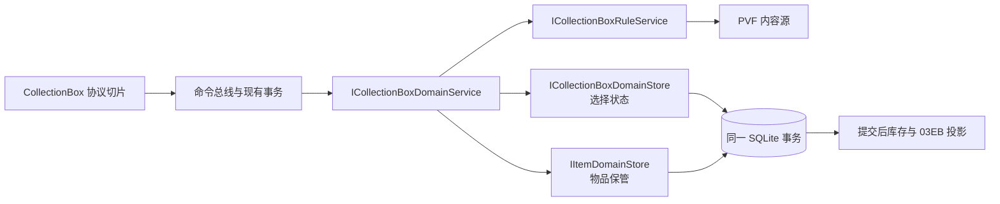

# 收集箱可行设计

日期：2026-10-19。代码基准：`b06e21d36b9b50bc500fc01d820fa718cea2d526`。
范围：[#164 收集箱](https://github.com/Gloria-GK-406/DNF-JP-86-Server/issues/164)，按[#170](https://github.com/Gloria-GK-406/DNF-JP-86-Server/issues/170)先于剩余活动地图推进。
状态：调查与设计，尚未实现、部署或实机验收。下文的接口、表和执行顺序属于 **Proposed**；客户端、内容与现有代码事实单独标证据。

## 推荐方案

**保存三套收集进度，每个角色选择一套生效；三套收集箱常驻，物品原实例由现有物品系统保管。**

以独立收集箱领域服务统筹放入、取出和选择，复用当前命令事务、物品容器与重放机制。服务端发送原生 A21 收集箱事实，由客户端已有路径计算和应用所选箱效果；不把相同加成再次写进服务端基础属性帧。

功能路线暂不需要客户端 EXE/DLL 补丁。常驻状态可由原生协议表达；静态说明里的历史日期另做最小 PVF 文案同步，不改物品 ID、槽位或奖励配置。是否完全不需兼容补丁仍由实机验收决定。

## 玩家可见规则

| 项目 | 本次设计 |
|---|---|
| 收集箱 | SAO、生肖之灵、三国志三套均可使用 |
| 生效选择 | 同一角色一次选择一套；切换时撤去旧箱效果，再应用新箱 |
| 收集箱期限 | 按用户决定永久有效，忽略历史活动到期日 |
| 物品自身期限 | 不随箱子永久化而取消；期限、封装、绑定等实例状态不得在往返中重建或清洗 |
| 放入 | 只接收该箱定义的物品，每个有效位置存一件；拒绝错误槽、重复位置及锁定／不合法物品 |
| 取出 | 从请求指定的箱查找该物品；返还保管中的原件或原堆叠的一件，按相容堆叠与容量规则落袋 |
| 延期券 | 常驻箱无需延期；延期请求在扣券前拒绝，不伪造成功，不消耗券 |
| 首次选择 | 尚无持久选择时，默认首个有效定义，当前为箱1；这是本服设计默认值，非原服历史规则结论 |
| 重登 | 恢复全部进度及该角色的选择，覆盖客户端可能残留的前一角色选择 |
| 三国空位 | 第12格为 `-1` 占位，不可放入，也不计奖励 |

PVF 声明的奖励如下；这是 **ContentStatic / High**，尚非实机数值证明：

| 箱 | 单件与满箱声明 |
|---|---|
| SAO | 5件稀有各四维+6、10件神器各四维+12；满箱力／智／体／精各 `5×6+10×12=150` |
| 生肖之灵 | 12件各物攻／魔攻+8、独立+12；满箱 `12×8=96` 物／魔攻、`12×12=144` 独立 |
| 三国志 | 11件有效卡片，各物攻／魔攻+8、独立+12；满箱 `11×8=88` 物／魔攻、`11×12=132` 独立 |

生肖、三国的说明声明不适用于决斗场。SAO 没有同一句声明，不据此替它增加相同限制；各箱的原生模式限制分别验证。

## 为什么这条路线可行

客户端镜像身份与首轮证据见[取证记录](CollectionBox-20261019.md)。以下新增消费者均来自同一 SHA-256 为 `52A9D002…AC72` 的 A21 映射镜像；地址为 **RVA**，结论为 **ClientStatic / High**：

- `03E5` 成功路径 `8A6A42–8A6A5E → 8A6660` 接收选择箱号，后者更新唯一选择，并只对该箱调用属性应用函数 `89F150`。
- `03EB` 的偏移1非零时，`8A766C` 起写入本帧箱号作为当前选择，再重新应用效果。它不能被理解为普通成功码。
- `03EB` 的偏移6写入箱对象永久标志；`899290` 判断标志是否大于零，`899340` 对永久箱直接判为有效，否则才看剩余值。
- UI 的 `8AAD10` 有永久、已失效、剩余天／小时分支。`8ABA15–8ABA70` 在没有选择时会寻找首箱并发送原生选择请求。

因此可以用 `remaining=0, permanent=1` 表达常驻；不能用 `remaining=FFFFFFFF, permanent=0` 代替永久，客户端会把该剩余值按非正值处理。

现有服务端 `CollectionBoxStateMessage` 发的是兼容 `0381`，选角只发送前两箱；它不是完整收集箱功能。真实进度要新增 `03EB` 路径，与固定两帧参照基线解耦。依据为 `SelectedCharacterStateMessageFactory.cs:93`、`StateSynchronizationMessages.cs:319` 及[0381记录](../protocol/game/server-to-client/NOTI-0x0381.md)。

## 领域与存储

接口名称为拟议名称，遵循仓库现有 DomainService／RuleService／DomainStore 分层：

- **规则服务**：独占收集箱 PVF 与本服常驻策略读取；提供箱子目录、物品到有效位置的映射、常驻状态和明确的不可放位置。它不查询玩家当前状态。
- **领域服务**：验证精确角色与物品事实，统筹放入、取出、选择；不直接构造协议包或查询 Socket。
- **选择存储**：新增 `character_collectbox_state(character_id PRIMARY KEY, selected_box_index NOT NULL)`。不保存可派生的加成值或历史倒计时。
- **物品保管**：复用 `items + item_slots`，增加一个仅供服务端的 CollectionBox 容器类型；在该角色容器内用具名映射函数编码箱号和箱内位置。此类型不成为客户端可访问的普通背包列表。
- **角色查询**：选角、恢复、实时查询和重放都读取上述同一份选择与容器事实；不另建在线可写副本，不维护两套进度真源。

隐藏容器必须从普通库存读取中明确隔离。现行 `SqliteCharacterItemTable` 的SQL只排除19–23，新增CollectionBox会被误送给只接受0／1／2／3／7的 `InventoryEntryAssembly.ParseContainerType` 并导致选角失败。实施时将普通角色库存读取改为这些既有入口类型的正向白名单，收藏内容仅由收藏查询读取；不得通过让普通背包接受隐藏类型来消除异常。依据为 `InventoryItemTables.cs:37–50`、`InventoryEntryAssembly.cs:125–145,426–436`。

容器位置映射可采用 `boxId×256+slotIndex`，前提是显式验证 boxId、槽位和协议数量上限；不要把乘数散落在业务代码中。数据所有者必须为角色，拒绝账号或任意容器地址。

`IItemDomainStore.SessionIn` 已支持将完整物品记录加入当前事务；`TakeAsync(reference,1)` 的拆堆会保留快照字段，`PutAsync` 使用 `CanStackWith` 判断合并。实现需扩充持久层的容器所有权／位置白名单及对应架构判据，不借新增列表绕过校验。

原子性有一个具体接线要求：新选择存储必须与物品存储使用完全相同的规范化 SQLite connection string 作为 `StoreIdentity`，通过 `SqliteDatabaseParticipant.Facet` 加入同一个连接和事务。不能各自新建连接／提交。当前 `DomainTransaction.Enlist` 对相同identity复用参与者，并拒绝第二个可失败提交参与者；依据为 `SqliteItemDomainStore.cs:11–24`、`DomainTransaction.cs:43–76`、`SqliteDatabaseParticipant.cs:10–20,43–64`。

**旧程序兼容有明确代价**：即使DDL仅新增选择表，CollectionBox新容器中的行也不能交给未修正查询的v0.2.6读取。不能宣称“只新增表，所以旧版可直接运行新存档”。实际部署需配套保存程序／PVF／配置和启用前数据库，回退必须一起恢复；恢复旧库会丢弃此后进度。若发布验收要求旧二进制直接读取新存档，必须先另做兼容路线评估，不能按本方案直接打兼容升级包。本设计不执行回档，也不把这项数据格式变化当作已经验收。

### 原物与旧数据

不能只保存 itemId 后在取出时调用发奖接口制造默认物品。现有 `ItemSnapshot` 包含 `ExpireTime`、`SealFlag`、`TradeRestriction`、锁等信息，`CanStackWith` 也比较这些状态；即便当前收集物是堆叠卡片／宝珠，itemId 也不是完整的物品状态。

旧 `character_collectbox_slots` 仅存 itemId，不能反推原物的全部状态。实施前先只读统计：

- 无旧行：新容器直接成为真源，旧表暂留，不做删除迁移。
- 有旧行：保留并列入迁移诊断，相关旧位置不允许新放入覆盖；不把旧行伪装为完整可提现物品，也不据此凭空发奖。取得原物备份或明确迁移规则后再受控转换。

常驻的是收集箱，不是原物的租期。第一版存入规则先拒绝带自身期限的物品以及已过期物品，避免把通用背包清理之外的期限维护问题藏进箱子；若当前可收集模板实际存在限时变体，须先补齐其箱内到期、失效与清理规则再开放这些变体。仅白名单itemId不够，必须核验实际快照。

## 操作与原子性

| 操作 | 同一事务中的执行 | 成功提交后 |
|---|---|---|
| 选择 | 验证箱号，UPSERT当前角色选择；重复选同箱可幂等成功 | ACK携带明确选中箱号；原生客户端切换效果 |
| 放入一件 | 核定箱／目标格和源槽当前快照，先检查目标空与全部资格，再Take一件并Put到箱容器 | 权威库存变化、完整该箱快照、ACK；只有当前箱才激活重算 |
| 取出一件 | 以箱号+物品ID定位确切原件，先验证兼容堆叠／空位与容量，再Take并Put回背包 | 权威库存变化、完整该箱快照、ACK；不能隐式选择另一个箱 |
| 延期 | 常驻策略下在任何消费前返回领域拒绝结果 | 仅规范拒绝ACK，物品不变 |

任一校验或写入失败，背包与收藏状态一起回滚。不得先改变客户端效果，再尝试提交数据库。新错误只定义领域原因，不把未知原生错误码写死进业务层。

放入和取出请求只对明确的当前选择箱接受，防止伪造包利用非当前箱改变效果；需要访问其他箱时先完成03E5。事务内重新检查所选箱，避免乱序请求套用旧选择。

选择、放入、取出接入现有选中会话校验、账户执行门和 effect settlement／重放能力。已提交请求重放只刷新当前事实；失败回滚可正常重试；同一重放键但不同请求内容按现有冲突规则拒绝。库存变化事件仍由物品领域产生，供任务等订阅者消费。

这不是仅勾选现有Inventory重放即可完成：新增 `ReplayProjectionNeeds.CollectionBox` 并扩充允许标志校验、当前事实快照读取和 `ReplayStateProjectionDelivery` 的03EB投递。快照包含全部收集进度与该角色选中箱；选择请求声明CollectionBox，放入／取出声明Inventory+CollectionBox。仅真实背包落点进入普通 `TouchedSlots`，隐藏收藏槽不伪装成客户端背包坐标。CollectionBox重放复用下文登录的先填充再激活顺序，不只重发库存而遗漏箱子与选择。依据为 `IReplayStateProjection.cs:14–45`、`ReplayStateProjectionDelivery.cs:67`。

## 协议与投递

当前静态复核支持以下结构；不是 WireCaptured 声明：

| 协议 | 请求／推送 | 成功响应 |
|---|---|---|
| CMD03E5 | `boxId:u8` | `01 + boxId:u8` |
| CMD03E6 | `boxId:u8 + reserved0:u8 + sourceSlot:u16 + itemId:u32`，8字节 | `01` |
| CMD03E7 | `boxId:u8 + itemId:u32`，5字节，不含背包目标槽 | `01` |
| CMD03E8 | `boxId:u8 + reserved0:u8 + ticketSlot:u16 + ticketItemId:u32`，8字节 | 常驻服不走成功分支 |
| NOTI03EB | `boxId:u8 + selectAndRefresh:u8 + remaining:u32 + permanent:u8 + count:u8 + itemIds:u32[count]` | 不适用 |

03E5–03E8拒绝体均为 `00 + error:u8`；具体领域原因对应的原生提示码还需差分核名，不能以“包长正确”代替错误语义正确。

**登录／重登恢复**：

1. 从同一角色当前事实读取三套进度和选中箱，保留独立的固定0381基线。
2. 三套真实03EB先全部以 `selectAndRefresh=0, remaining=0, permanent=1` 填充客户端缓存。
3. 最后对选中箱再发完整03EB，设置 `selectAndRefresh=1`，将选择和属性一次恢复到明确目标。多发这条是本服保守投递策略，不声称原服必须采用完全相同帧序。

**修改投递**：首次策略采用提交后“权威库存 → 03EB → ACK”，参考上游顺序，并在原生客户端抓包／界面验证后固定。它不是已验证 A21 原服顺序。选择成功通常由 `[01,boxId]` ACK即可触发原生切换；仅状态纠正或完整恢复时另发03EB。

完整快照按PVF有效位置排序发送itemId，不把 `-1` 空位作为物品，也不信任客户端提供物品来生成快照。03EB偏移1和偏移6分别是选中激活、永久有效，不能共用一个布尔字段。

## 属性职责与生命周期

**本期只同步箱内物品、永久状态和选中箱，不再往服务端基础属性加一遍奖励。** A21已有单箱修饰应用链；当前服务端的派生属性记录并非完整战斗合成器，且没有独立攻击字段。直接把收集箱奖励加进旧字段既可能丢信息，也可能与原生客户端重复应用。

选择切换、当前箱增删和完整恢复通过原生路径重新计算所选箱。非当前箱状态纠正只更新进度。换宠、进本、回城是否重建同一属性目标仍需实机确认：先观察现有恢复节点，再在确实重建目标的节点补发同一当前箱快照，不无依据向每次事件广播所有箱。

若将来建立服务端权威战斗属性，收集箱应作为按来源可替换的单项贡献参与聚合；这不是本次为了收集箱附带启动的全服属性重构。

## 实施顺序与验收

| 步骤 | 可观察交付与必要检查 |
|---|---|
| 协议与只读显示 | 三箱列表、永久状态、首选／切换路径；补齐拒绝提示语义和03EB两个标志差分 |
| 容器与选择存储 | 新容器owner／位置检查，原物拆堆与合堆往返，选择持久化；箱内已有物品后重新登录／库存重放成功且隐藏物不混入普通背包；旧表诊断，无数据凭空生成 |
| 原子放入／取出 | 错箱／错物／锁定／限时拒绝、重复格、满包；Take后Put或选择状态facet flush故障时，原位置／完整快照／选择全部回滚；重放时三箱+selected与当前事实一致，不再移动物品；跨角色隔离 |
| 原生属性闭环 | 单件与满箱增益、切换撤销旧增益、不叠加；重登、换宠、进本回城；生肖／三国决斗场边界 |
| 验收包准备 | 同步最小说明文案、保留旧程序／PVF和数据库备份，完成自动回归与用户实机验收；另行执行实际部署 |

当前可行性结论是：**领域和存储路线可落地，A21能表达永久与单箱选择；完整玩家闭环仍需实施和实机验证。** 技术未决项是拒绝码提示、投递顺序及生命周期属性恢复，均有明确且有界的客户端验证方法，不需要用猜测或提前修改客户端绕过。
