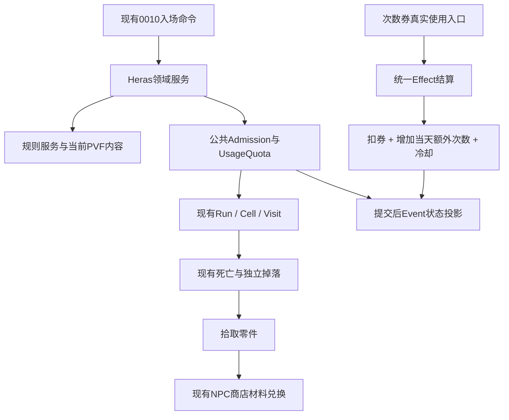

# 赫拉斯研究所3×3一期预设计

日期：2026-10-16。状态：供用户评估，尚未进入实施；不是已批准规格或实现完成记录。
来源：[调查报告](HerasResearch-20261016.md)，当前源码基线`a8141a74`。
当前工作分支`task/next-round-20261013`；相关任务[#157](https://github.com/Gloria-GK-406/DNF-JP-86-Server/issues/157)。

## 1. 目标与范围

以客户端和服务端一致的现行3×3内容，完成“地图可见 → 合法单人入场 → 房间战斗/随机中Boss → 通关/拾取零件 → 吟荷兑换装备 → 再次挑战”的玩家闭环。

旧5×5已单列[#160](https://github.com/Gloria-GK-406/DNF-JP-86-Server/issues/160)，包括陷阱、随机传送、Buff和旧特殊Boss机制。
本期不补旧标志、不改变迷宫尺寸、不把旧global传送表接进3×3、不接旧陷阱协议。
“减负时改成3×3”保留为合理假设，不据此宣称版本历史已证实。

## 2. 规则草案

| 规则 | 一期方案 | 依据/状态 |
|---|---|---|
| 入口 | 格兰之森山麓，DGN3900，活动2367 | PVF已确认 |
| 等级 | 最低50；不因推荐上限86另造硬上限 | PVF minimum/recommended分开 |
| 队伍/模式 | 仅单人；拒绝练习、循环、镜像和深渊混用 | PVF及模式职责 |
| 难度 | 所有入场事实和布局规范为PVF固定难度1 | 不信任请求改变固定难度 |
| 疲劳/门票 | 不耗疲劳，可零疲劳入；不消耗旧钥匙10093393 | DGN无耗票声明 |
| 怪物等级 | 入场时取角色等级并冻结本局；副本内升级不重建怪等级 | 复用Tau/通用layout字段 |
| 活动 | 默认全天开放，GM2367开关/时间窗优先；关闭阻止新入场，已开局可正常完成 | **本服策略建议，待确认** |
| 基础次数 | 每角色每游戏日3次；成功创建一局消耗1次，放弃/断线不退 | 数值3有PVF依据；收费时机为策略建议 |
| 日切 | 复用现有DailyResetRuleService；当前配置北京时间06:00 | **本服策略建议，待确认；非历史还原结论** |
| 额外次数 | 490002847使用后增加当天可用次数1；当日累计，下一周期归零 | action增1已确认；有效周期为策略建议 |
| 计数公式 | remaining=max(0,3+bonusGranted-entriesUsed) | 基础、额外和使用分开记录 |
| 兑换 | 复用吟荷NPC20152、商店1277中的赫拉斯装备及其材料价格 | 本轮补查确认，见附录 |

活动开关、跨日和重登只重建状态，不返还已消费次数。不补离线历史天数。
次数券的“每天购买2张”是购买限制，不能转成“每天最多使用2张”；使用遵守内容、冷却、期限和协议表示上限。

## 3. 最小结构

新增概念控制在三处：

| 层 | 拟新增/扩展职责 | 不承担什么 |
|---|---|---|
| Infrastructure内容源 | 读取3900的资格、固定难度、活动与次数配置，校验3×3完整占用格及MAP候选 | 不读取玩家、不开局 |
| Heras规则服务 | 给定内容和角色/计数facts，产生资格、布局与次数决定；冻结等级；处理券的增次规则 | 不查数据库、不发包 |
| Heras领域服务 | 编排资格、公共准入、实际入场及计数快照；次数券领域用例协调effect | 不复制战斗、掉落或物品派发 |

Protocol仅负责实际入口解析、调用命令及应答/投影。Application业务不直接读PVF，命令处理器不注入内容源/规则服务。
普通Run/Cell足以承载现行3×3；不建立另一个赫拉斯战斗运行时或可复访刷新的Boss账本。

## 4. 计数与入场事务

继续使用现有`character_daily_counters`、UsageQuota的CAS及DirectAsync事实订阅；拟补赫拉斯配额族及其日期key。
每角色每周期两个非负值：`entriesUsed`和`bonusGranted`，不改成用负used表示加次数。无需新增玩家表；实现前检查现有schema和key约束。

入场流程：

1. 确认当前选中会话、单人、模式、活动、等级及不在别的run。
2. 读取本周期账本，确认remaining>0；读取/冻结本局布局与等级。
3. 公共Admission签发凭证，通过同事务的DirectAsync事实CAS把entriesUsed增加1，再创建Run/首房。
4. 后续任一环节失败，整个事务回滚，次数不扣、半局不残留。已有Admission的RequireRollback和runtime回滚机制复用。
5. 提交后发送既有成功/失败应答及当前次数投影。再次挑战进入新局并再消费1次。

不得把计数扣除放到异步EventBus中。异步订阅仅用于提交后的刷新，不能成为准入判定真源。
跨06:00已经在局内的玩家可打完旧局；下一次入场和之后使用券依据当前周期，不能再次给旧局扣次。

## 5. 次数券使用与Effect

现有490002847动作是`[add enter limit dungeonincount] 1 3900`；当前服务尚未实现该动作。
先核对原生客户端实际发送的CMD及载荷，不假设它一定走普通002C；兵书001E缺入口的教训纳入回归。

新增一个有明确目标地城/增量的增次数effect，由拥有计数的领域边界校验和结算，普通使用规则继续提供等级、地点、期限、冷却和消费决定。
同一计划：`ConsumeFromContainerEffect(1)` → `AddDungeonEntryAllowanceEffect(3900,1)` → 已有冷却effect，
统一`ApplyEffectsDomainService`和外层事务收口；effect通过现有DirectAsync计数真源写入，不直接绕过UsageQuota改SQL。

- 成功：扣一张券、bonusGranted+1、剩余次数立即刷新；重登保持。
- 不合适地点、已过期、冷却或目标/增量不支持：失败应答，物品和账本均不变。
- 写次数失败、扣券失败或提交失败：一起回滚；重复同一请求不重复扣券/增次数。
- 现有0227的remaining是u8，增加后不可表示时明确拒绝且不扣券，不静默截断。
- 未确认的额外动作保持拒绝；不把所有etc类道具默认消费掉。

本期券的自然售卖入口需在现有活动/商店列表核对：已确认吟荷赫拉斯tab不含490002847，因此不擅自往商店加商品。
可先用既有GM发放测试券做使用验收，实际发放需沿用用户授权和现有GM流程。

## 6. 地图、怪物与零件

保持3×3九个位置及DGN原连接，起点(0,0)、Boss(1,1)。仅(2,0)在27116/25644/25645中按既有MAP候选规则选一，入场冻结，复访不重抽。
主Boss64923；中Boss64930/31/32；精英110920/110921。普通怪、特殊对象、死亡、过图、结算、翻牌、回城及再次挑战沿用既有管线。
关底Boss死亡和房间完成条件遵循当前通用权威账本，不为本期发明旧隐藏Boss条件。

零件490002846已在独立掉落表：主Boss必出2个，再独立60%出1个；上述中Boss/精英各必出1个，再独立60%出1个。
这些是当前规则对PVF的推导，实施测试必须验证真实怪物等级、源类型、难度、元数据和防重复条件。
**不在通关或翻牌额外补发同一份零件**，避免与现有独立掉落叠加。拾取满包按既有地面物品策略保留，不擅自改成邮件。

## 7. 兑换范围及附属物品

本期至少验收“拾取零件 → 吟荷赫拉斯tab → 按内容材料成本换一件装备 → 重登保持”，继续使用NPC商店的材料消费、容量预检、实例生成和事务。
例：300340000 MLA-600机械臂章需490002846×85，最低装备等级80；购买与穿戴资格按现有规则分别处理，不把研究所最低50级改为80。

商店还含490002848 MLA升级券和490002849的1点疲劳药（名称以PVF为准）。前者的装备转换动作在当前服务未找到实现，
不将“能购买”当作“能升级使用”，升级券效果列为后续能力，使用入口必须明确拒绝并保留券。
后者已有通用疲劳effect可复用，适用性与限购字段需验证；不为其重写研究所业务。
当前档案的`[daily purchase limit] chraracter 1/2`存在拼写变体，既有NPC解析器只接受character/account，实施时要有界兼容并保留未知值拒绝。

旧能量残骸10092630、秘密保险柜10093401及2016年到期兑换链不混入本期；不因为旧文本存在就批量修过期声明。

## 8. 客户端刷新

- 活动2367启用/禁用与3900调度状态由同一真源生成，登录、打开地图和在线变更一致；GM关闭后只拒绝新入场。
- 033F沿用已确认的四u32布局，contentId=3900；category/state等按当前受调度内容链核验，不复制Tau的活动详情字符串。
- 2367活动详情必须核对客户端解析能力；不能凭名字伪造taukingdom或timespiral扩展文本。
- 剩余次数复用0227绝对快照，入场、用券、登录、加载完成和在线跨日均读同一账本。
- 完整角色状态替换旧硬编码(3900,3)，避免它覆盖动态余量；保留旧条目其他已确认字段和顺序。
- 事务后统一投影；失败也返回对应操作的完成/拒绝应答，保证客户端UI恢复。
- 当前3×3不发送0408陷阱结果、0226条件门或旧随机传送包。若实机出现相关请求，应回查活动版本，不能临时套用上游短包。

## 9. 验证与实施顺序

| 单元 | 可交付行为 | 关键回归 |
|---|---|---|
| A 内容/入口/基本战斗 | 50级单人可见并进入当前3×3，固定难度/等级/疲劳正确 | 双端内容一致、九格/三MAP候选、低等级/组队/活动关闭拒绝、零疲劳放行 |
| B 权威次数与投影 | 基础3次、重登/重启不重置已用次数、第四次拒绝 | 入场中途异常回滚、重复请求、在线日切、完整状态不覆盖0227 |
| C 次数券effect | 扣券和增次同事务、客户端完成操作 | 实际注册decoder原始载荷、期限/地点/冷却、SQL故障回滚、重放及u8上限 |
| D 掉落/兑换闭环 | Boss/精英产零件，商店换装备，退出/再次挑战正确 | 独立行确定性抽签、重复死亡不复发、复访不重刷、满包/材料不足回滚 |
| E 实机收口 | 原生客户端正常体验 | 49/50级、三次耗尽、用券再进、角色切换、重登、活动关闭/开启和在线跨06:00 |

相关合成测试不隐式依赖真实PVF；再用部署PVF做内容回归与原生客户端验收。代码测试不替代WireCaptured/ClientVerified。
实施后按已授权部署条件备份SQLite并核对进程/哈希/健康；本预设计本身不部署，也不修改玩家测试角色或数据。

## 10. 可实施性与评审点

**可实施，主要工作是接玩法规则、次数账本、使用券effect和一致投影；无需复制一套地下城运行时。**
当前阶段应评审三项：全天活动策略、按现有06:00游戏日重置3次、券额外次数仅当天有效。
这些决定只影响本服规则，不要求先还原旧5×5协议。其余风险是A21入口可见门和券真实协议入口，
应在单元A/C先做有界核验，未闭合时不靠猜包推进。

## 附录：本轮补查

- NPC20152`npc/chn_npc_Dayofthedungeon.npc`：name=吟荷，role=`[item shop] 1277`。
- `itemshop/itemshop.lst`1277→`chn_dayofdungeon_shop.shp`，赫拉斯tab含490002848、490002849及15件30034/35/30/31/32系列装备。
- 300340000：`[need material] 490002846 85`，minimum level80。
- 490002848：材料100零件，动作`[equipment item period change]`，含装备映射；当前源码未发现该动作实现。
- 490002849：材料14零件，daily purchase limit=`chraracter 1`，`[add fatigue] 1`。
- 当前`Game:DailyResetTime=06:00:00`；代码与runtime配置均一致。
- 旧5×5 issue #160已创建。连接器企业账号写入403，改用本机已验证的Gloria-GK-406个人凭据创建成功，未切换默认账号。
