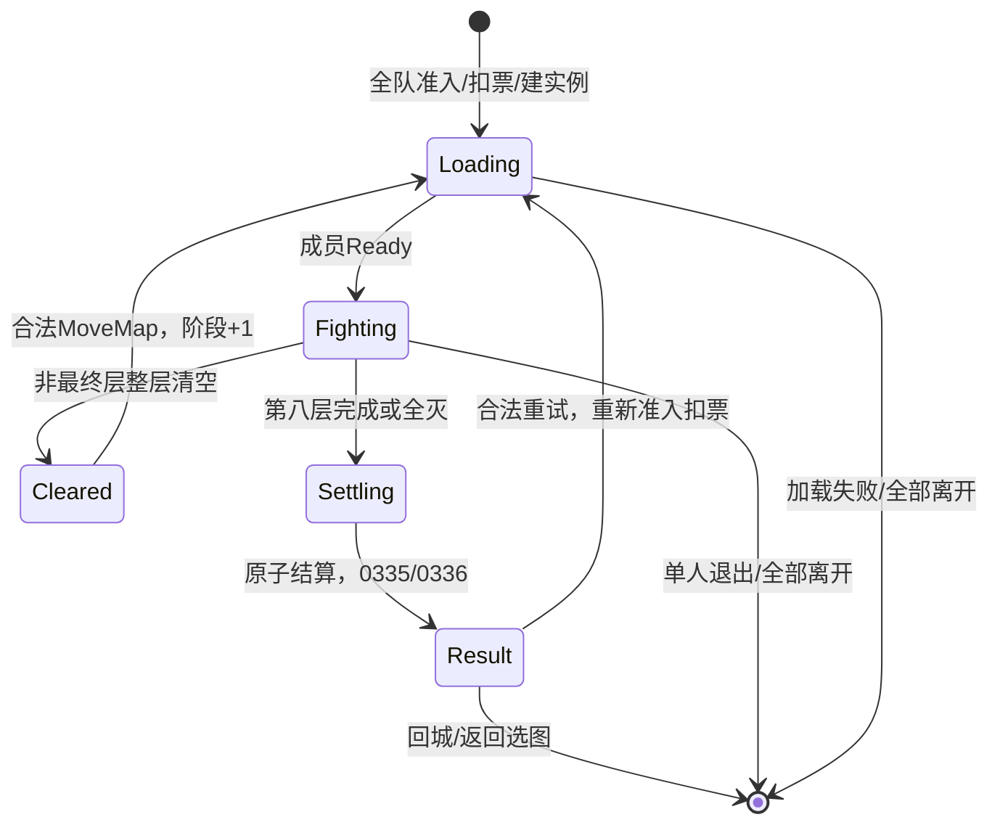

# 领主之塔：入口核实与可行设计

日期：2026-10-19。基准提交：`46d3ffbe07a77b21f8747676c6416f5b72754986`，分支`task/next-round-20261019`。对应[#165](https://github.com/Gloria-GK-406/DNF-JP-86-Server/issues/165)。本方案现已落地为完整服务端候选；代码、协议与自动验证见[实现边界](LordTower-Implementation-20261019.md)。部署及用户原生实机验收由主流程继续完成，当前不标ClientVerified。

## 结论

可以继续实施当前资源中的3505领主之塔。用户确认当前亡者峡谷看不到入口；本次已将原因收敛为一个明确的服务端缺口：当前PVF把3505列为调度内容，A21没有收到其开放状态就会过滤，而现服既未注册2329活动，也未投影3505。正常接入现有活动及033F通路应能开放入口；这仍是ClientStatic与现场配置支持的高置信结论，必须在接线后验证实际槽位显示与点击，不能宣称已ClientVerified或已穷尽所有过滤分支。

不需要给3505机械追加69/75，也没有证据要求修改PVF入口或客户端。玩法采用专用八阶段运行态，不能伪造成普通八格迷宫；准入扣票、物品、任务、经验、商店交易与通知尽量复用现有领域能力。

## 入口与现场证据

当前PVF SHA-256：`C5CCE5346F60D21128D756A086EEF96E70F75F2F2FE063B6C61C00506C588F06`。

1. `worldmap/towers.wdm`含`3505 -1`；DGN3505带schedule2329和`Tower_cn.img`槽位。
2. 同一档案`etc/chn_schedule.etc`的`[dungeon]`确有完整3505记录；不是仅凭DGN中的schedule字段推测。
3. A21 `011C4B54`加载该文件，`011C525B/011C52E5`建立类别0调度名单。选图`0271D854→011C2160→011C3030`识别调度DGN，随后`0271D886→011C2530→011C2190`要求对应状态1或2，缺记录/状态0就过滤。
4. 后置过滤`02736B90`中，已开放的调度内容绕过69/75隐藏拒绝分支。无需照搬南部、牛头的伴随活动结论。
5. 当前Application注册和`EventPlayerSnapshotProjection`都没有领主塔；只读现服数据库也没有2329配置。没有配置行本身不等于关闭，因为其他活动可有默认配置；本案缺的是受管活动注册及3505投影整条接线。

建议入口链：`受管活动2329 → ScheduledDungeonState(3505, Open) → NOTI033F`。其16B正文为四个u32：`category=0,state=1,contentId=3505,opaque=0`，十六进制`00000000 01000000 B10D0000 00000000`。关闭显式发state0；选角及在线活动更新使用同一投影。2329是本服配置身份，不能填入contentId代替3505。

现场补票实际启用：`daily_refill_settings`无覆盖或禁用记录；角色8持有2749110×3，待收此物品邮件0，当日补给账本已记录。当前仍是UTC+8午夜普通选角补给，尚未接统一06:00在线刷新。本次只读CIM及SQLite（mode=ro、query_only），未改玩家资产或活动状态。

## 建议采用的规则

| 项目 | 设计 | 依据与边界 |
|---|---|---|
| 开放 | 沿本轮活动图策略默认常驻，由GM独立启停2329。 | ServerPolicy，不搬历史周末或日服木/日开放时段。 |
| 准入 | 60级，禁止练习；默认难度0，每位有效参与者扣邀请函2749110×1。拒绝或建房失败全员不扣。 | 当前PVF；不能只检查或扣除队长材料。 |
| 人数 | 本轮建议支持1～4人；同账号、角色、槽位不得重复。 | 沿现有本服party能力的ServerPolicy；当前DGN缺显式上限，原生默认值未闭合。A21八成员槽容量不是准许八人。 |
| 次数 | 门票控制入场，不额外增加“每日硬限三次”的额度。 | PVF是补足三张、堆叠五张；不等于每日累加三张或独立硬上限三次。 |
| 补票 | 建议与其他活动一致，每日北京时间06:00补足三张，支持在线和重登；保留GM Effective开关及待收邮件计数。 | 改动现有午夜策略，属于ServerPolicy；复用独立period和调度器。迁移旧claim不能倒退账本、当日补两次。 |
| 疲劳与虚弱 | 显式塔模式免疲劳、允许零疲劳进入、退出及全灭不新增普通虚弱；不清除已有虚弱记录。 | 70塔分支绕过普通CheckMemberFatigue/dungeon_start及giveup_panalty；不通过改普通PVF flag伪造规则。 |
| 死亡与消耗品 | 禁复活币；普通合法消耗品可用。建议禁止人偶召唤，保留当前通用物品资格检查。 | 前两项有70Reference；人偶的70服务端禁用分支未闭合，显式列ServerPolicy。 |
| 推进 | 八阶段按当前29张MAP加权池选择；整层清空后等待合法MoveMap推进，不在末怪死亡时自动切层。 | PVF阶段池与70流程；不把客户端X/Y当权威阶段数。 |
| 全灭 | 第k层全灭按到达的当前k层结算，非只按已清k−1层；退出者不在后续奖励成员中。 | 70Reference；显式保存CurrentStage与LastClearedStage避免混淆。 |
| 主动退出 | 不退门票，不给退出者专用终局奖励，保留合法已拾取资产；单人退出结束实例，多人退出更新成员及队长。 | 70Reference与本服会话生命周期要求。 |
| 限时 | 不臆造每层或整局硬性战斗限时。加载超时与结果页返回使用独立状态及调度。 | 70的90/120秒是Ready超时，5秒结束过场/20秒回城也不是战斗时间。A21实际交互时序留待验证。 |

## 奖励设计

塔有两条独立经验来源：塔专用逐怪经验，以及终局经验。70的`KillMonsterGetExp`在`0814D581`直接入经验，终局另算当前阶段公式；应以塔经验上下文替代普通副本逐怪经验，不能重复叠成普通逐怪、塔逐怪、塔终局三份。

终局基础经验采用`trunc(k × 当前等级mobReward × expWeight[k])`，再由统一经验领域处理本服支持的通关加成与塔上限；70最终上限为1,100,000。当前八层基础为32倍等级基准经验，不是八项权重相加。逐怪经验读取当前`monster exp weight=1`及`apc exp weight=3`，不复制旧70数值表、加成或PRNG。

奖励格数量为`min(cardCount[k], DGN最大结算物品数, 10)`；当前满八层最多10格。参数50/49/100在70被累积成50/99/199，生成函数比较前两项乘`min(k,10)`，其余为空格。按通常0～999抽样，八层每格约40%走金币分支、39.2%走随机物品分支、20.8%为空；物品分支还有自己的生成判定，不等于39.2%必定获得物品。金币为通用结算金币生成结果乘当前PVF权重11，并非1.1或11%。具体金币、装备池及稀有度仍读取当前PVF和本服生成器。

死亡掉落仅接入当前PVF可证的独立掉落和塔指定来源。70`killMonsterDropItem`调用`generateIndependentItem`，APC另有指定物品门，没有普通随机/世界掉落调用；不把普通副本掉落总入口整体叠加过来，也不硬编码每怪固定掉碎片。任务击杀事实仍走既有事件链。

结算按当前有效成员生成一次并原子发放一次，背包不足复用InventoryThenMail；0335只读同一结果。A21固定八组对应成员槽，实际1～4人按各自slot填入，未占用槽count0；不是给每一层各填一组。金币itemId0、空格itemId−1的语义需与实际发放和UI一致。

## 架构与事务边界

| 边界 | 建议实现 |
|---|---|
| 静态内容 | `PvfBossTowerContentSource`读取3505八阶段池、global_bosstower参数、NPC与MAP。共享PVF公共header解析，启动校验阶段池、权重和必需字段。 |
| 准入 | 从普通Maze定义拆出真实`DungeonAdmissionDefinition`，包含等级、难度、材料及限制；普通图和塔共享解析与判定。难度规则也消费该准入视图，不能二次读取无maze的旧source后误用默认值。 |
| 扣票与建房 | 同一写事务执行现有Prepare/Consume/BeginEntry，再建立专用run。现有ExecuteAsync要求普通DungeonPartyEntry，不直接伪造该结果；按实际接口采用低层三步骤，并确保所有故障回滚扣票和运行态。 |
| 跨模式占用 | 普通副本、死亡/迷妄塔与领主塔共用事务性参与占用检查，建立与释放绑定run/session。避免新Boss域依赖通用准入、通用准入又反向依赖Boss域的DI环。 |
| 纯规则 | `BossTowerRuleService`负责按冻结seed抽图、阶段奖励、掉落过滤及准入策略；不自行查询或改变世界状态。 |
| 运行聚合 | `BossTowerRun`持有runId、成员及session generation、当前/已清阶段、roomVersion、已选MAP、actor/drop身份、Ready/死亡状态、结算结果与发放状态。借鉴现有塔的事务克隆，不共用同一份玩法状态。 |
| 协议 | 既有0010/0025/0027/002D/0048按当前玩法分流；专用0333/0334/0335/0336投影。所有阶段变更在事务提交后投递，拒绝、回滚或重放不额外扣票、抽图、发奖。 |
| 地下城NPC | Boss域签发仅绑定当前run、roomVersion、session和地图真实1010/商店1118的内部授权，再复用NPC商店报价、扣材料与发货核心。现有town-only授权不能直接放开，也不能接受客户端传来的“已授权”标记。 |

NPC1010当前资源有商店，但现有`NpcShopDomainService`仅检查town成员、没有run/map授权；可读取商品不代表已经具备地下城交易闭环。购买及开启继续使用当前已修正的材料语义，不能把购买材料再次作为开启收费。

重试必须创建新run并重新校验活动、成员、票和占用，不能回放旧结算。多人离队、断线与队长更换在聚合中处理，不让旧session领取替代session的奖励。

## 持久化

本轮建议沿其他单局活动的边界：门票、补给账本、金币、物品、任务和已提交经验使用现有持久化；战斗阶段/选图结果/演员等运行态不作为可续闯存档。断线重登或重启后回城，不恢复半场、也不退已成功入场的票；已提交资产保留。

结算结果与运行完成标记在同一领域事务提交，重复请求只重投影；进程恢复后旧run不能再次接受领奖。若将来要求跨重启继续闯塔或离线重放结算，则需另建持久run/收据模型，不在此方案中暗含支持。

## 仍需实施后验证

静态规则和可行接线已足以进入实现设计，不要求先修改现服注包验证。以下保留为第一轮原生验收条件：

1. 正常033F投影后亡者峡谷显示并可选3505；关闭活动后隐藏且服务端拒绝绕过入场。
2. 一次合法入场的ACK、背包扣票与0333/0334顺序；全员Ready后正常开战。
3. 第一层清怪后走门002D、第二层0334/加载的坐标及顺序；客户端X/Y不是任意跳层凭据。
4. 0335按成员显示金币/物品/经验、空槽正确，0336控制重试。0048已确认`event+btnIndex`及重试候选`01 00`；不能把event1全部当立即回城。三个按钮与ACK已由本轮静态闭合：btn0/1/2为重试/别图/回城；原生视觉及多人表现仍待实机。
5. 单人、多人全灭、队员退出、重登/重启、背包满、奖励故障回滚、重复击杀/走门/领奖、06:00在线与重登补票不重复。

建议实施顺序：先做活动入口与单层入场/加载/走门的最小闭环，验证原生链后完成八阶段、奖励和NPC兑换，再统一部署验收。它们属于同一领主塔功能范围；不先交付“入口已能点但玩法未接好”的现服版本。

## 依据

- [上一轮资源与结构调查](LordTower-Research-20261019.md)。
- [本轮A21入口、成员奖励组及交互补证](../artifacts/lord-tower-verification-20261019/protocol/report.md)。
- [当前PVF、现服只读检查及接口建议](../artifacts/lord-tower-verification-20261019/pvf/verification-and-design.md)。
- [70规则、经验与掉落证据](../artifacts/lord-tower-verification-20261019/reference/findings.md)。
- 协议权威记录：[033F](../protocol/game/server-to-client/NOTI-0x033F.md)、[0333](../protocol/game/server-to-client/NOTI-0x0333.md)、[0334](../protocol/game/server-to-client/NOTI-0x0334.md)、[0335](../protocol/game/server-to-client/NOTI-0x0335.md)、[0336](../protocol/game/server-to-client/NOTI-0x0336.md)、[0048](../protocol/game/client-to-server/0x0048.md)。

CurrentImplementation、当前PVF、ClientStatic、70Reference与ServerPolicy分别标注；用户仅确认当前入口不可见，没有新增激活后WireCaptured或ClientVerified。本方案不将旧日服历史时段、人数或兑换奖励混入当前CN资源配置。
