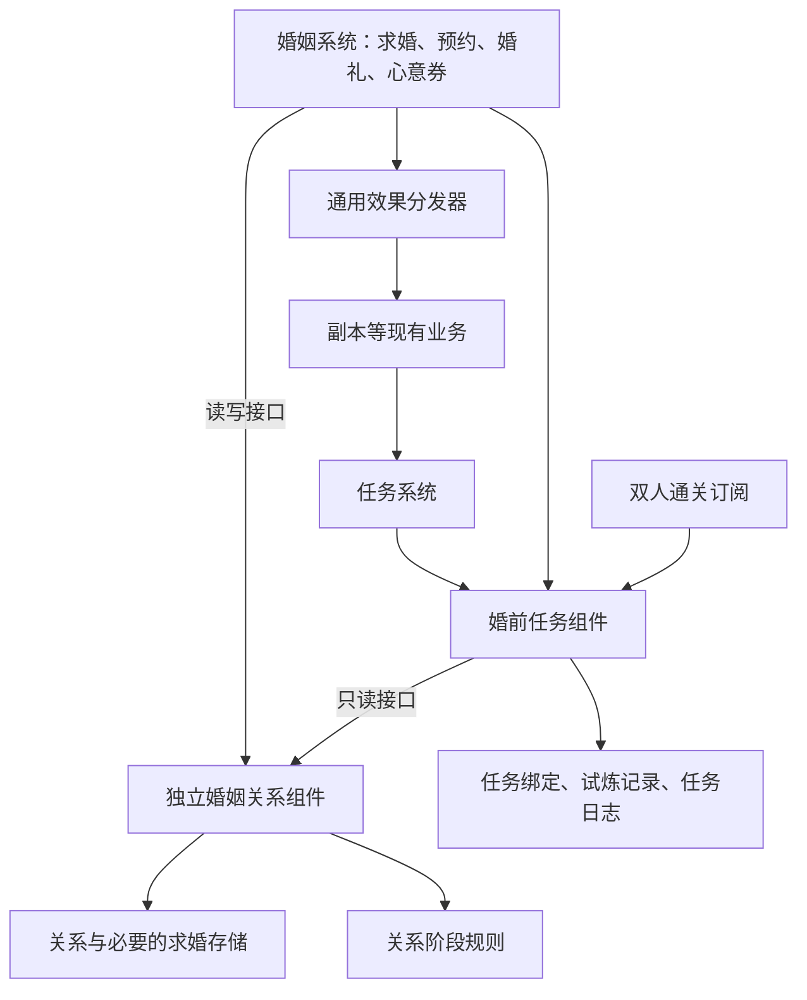

# 婚姻系统审核与关系组件去环方案

- 日期：2026-10-17（Asia/Shanghai）。
- 审核基准：`31e7a91ae15e4a98fc19add056166f4487515243`，`refactor(marriage): merge eight services into one entity with a stored stage`。
- 重构前行为基线：`5a0cbed0d5a8d8a9aff4cbcd4a0401e9bb81a3ed`。
- 分支：`task/next-round-20261013`。
- 范围：已有婚姻合并实现、DI 依赖环、关系与任务职责、迁移回退边界，以及下一步重构建议。
- 交付状态：审核与设计建议。本文未实施去环、变更协议、迁移运行库或部署服务。

## 1. 审核结论

```yaml
kind: rks-review
verdict: changes_required
```

该结论针对当前依赖结构及相关证据缺口，不表示已证明当前版本启动失败或玩家流程不可用。当前延迟解析版本的相关自动化测试通过，但依赖环被工厂推迟到了使用时，并未从业务依赖图中消除。

值得保留的成果：关系阶段有独立持久记录；参与者身份判断收敛；阶段与心意点写入集中到 `CoupleLedger`；婚姻主要业务有统一入口及行为回归保护。没有必要因此恢复原来的八个独立服务。

下一步主方案采用用户提出的方向：**提取独立婚姻关系组件，提供只读接口和读写接口；婚姻系统使用读写接口，任务侧通过轻量婚前任务组件使用只读接口。** 心意券可以继续使用通用 effect。

“独立组件”指进程内职责和依赖边界，不要求新增进程、数据库、Host 或 ServiceProvider。

## 2. 证据等级与验证边界

| 标记 | 本文含义 |
|---|---|
| Confirmed / CurrentImplementation | 已直接核对当前源码、注册或测试日志 |
| High / 代码推导 | 由源码推导的风险路径，尚未完成对应端到端复现 |
| 待验证 | 需要针对性测试才能判断是否构成实际缺陷 |
| 设计建议 | 后续拟实施结构，不是当前已落地事实 |

本次审核中执行过的验证，日志位于现有 `artifacts/wedding-six-fix-20261017/`：

| 验证范围 | 结果 | 日志 |
|---|---|---|
| Application 中名称包含 Marriage 的测试，使用实际 PVF | 94 通过 | `marriage-review-application.log` |
| MarriageRelationMigrationTests、MarriageWeddingMigrationTests、SchemaOwnershipTests | 5 通过 | `marriage-review-migration.log` |
| Protocol 测试项目 | 1528 通过、60 跳过 | `marriage-review-protocol.log` |

日志目录绝对路径：`E:/Project/DNF/DNF-JP-86-Server/artifacts/wedding-six-fix-20261017/`。

本报告写作时复核了上述日志和基准提交，未重复执行相同测试。已有测试结果不证明依赖图无环，不代表当前重构已通过双端 A21 实机验收，也不覆盖负载、性能或所有新旧版本切换情形。未对运行数据库执行迁移；协议源码和服务端测试不应被标为新的 ClientVerified 证据。

## 3. 已确认问题与可能缺陷

### F1：心意券通过延迟解析保留了一条依赖回环

**级别：P2；Confirmed / CurrentImplementation；结构审核需要修正。**

当前构造依赖路径之一：

```text
MarriageDomainService
  → LovePoints
  → Func<IApplyEffectsDomainService>（使用时解析）
  → ApplyEffectsDomainService
  → IEnumerable<IEffectHandler>
  → DungeonEntryAllowanceEffectHandler
  → HerasDungeonDomainService
  → DungeonAdmissionDomainService
  → IllusionTowerDomainService
  → IllusionTowerRewardDomainService
  → QuestProgressDomainService
  → SeekingQuestProgressDomainService
  → QuestFactsDomainService
  → IMarriageQuestDomainService
  → MarriageDomainService
```

这是一条对象依赖链，不能理解为使用心意券时会实际执行贺拉斯或迷妄之塔逻辑。`ApplyEffectsDomainService` 构造时收集全部效果处理器，即使当前计划只有扣券，也会带上这些处理器的构造依赖。

现有 `Func` 能推迟解析，已有测试证明这种接线在所测路径下可工作；其结构后果是任务资格查询与完整婚姻执行流程互相依赖，容器无法通过直接构造器检查揭示真实回边。仅把 `LovePoints` 的方法搬入婚姻主类，依赖环不变。

证据：[LovePoints.cs:30](/E:/Project/DNF/DNF-JP-86-Server/Server/src/Dfo.Server.Application/Marriage/LovePoints.cs:30)、[ApplicationModule.cs:154](/E:/Project/DNF/DNF-JP-86-Server/Server/src/Dfo.Server.Application/ApplicationModule.cs:154)、[ApplyEffectsDomainService.cs:19](/E:/Project/DNF/DNF-JP-86-Server/Server/src/Dfo.Server.Application/Effects/ApplyEffectsDomainService.cs:19)、[QuestFactsDomainService.cs:14](/E:/Project/DNF/DNF-JP-86-Server/Server/src/Dfo.Server.Application/Quests/QuestFactsDomainService.cs:14)。

### F2：效果处理器依赖范围过宽，扩大了跨领域耦合

**级别：P2；Confirmed / CurrentImplementation；可独立优化，不是新主方案的前置步骤。**

`DungeonEntryAllowanceEffectHandler` 需要校验、增加入场额度，却依赖整个 `IHerasDungeonDomainService`，进而拉入副本入场、运行、塔奖励及任务依赖。这是 F1 路径中的一个可收窄边界。

可将额度读取、校验、变更整理成同一底层能力，供副本入场、补次数道具与效果处理器复用。新的关系组件方案已能从任务侧切断 F1，因此不应把额度整理扩大成本次必须重构整个副本系统的要求。

证据：[DungeonEntryAllowanceEffectHandler.cs:6](/E:/Project/DNF/DNF-JP-86-Server/Server/src/Dfo.Server.Application/Effects/DungeonEntryAllowanceEffectHandler.cs:6)、[HerasDungeonDomainService.cs:13](/E:/Project/DNF/DNF-JP-86-Server/Server/src/Dfo.Server.Application/World/HerasDungeonDomainService.cs:13)。

### F3：现有架构测试只能证明局部形状，不能证明无环

**级别：P2；Confirmed / CurrentImplementation；应随去环补充。**

`MarriageArchitectureTests` 读取构造器直接参数，检查组件互不直接引用、存储接口归属及组件数量。它没有追踪传递依赖，也没有分析注册工厂中隐藏的 `GetRequiredService`。因此，F1 可以存在而这些测试仍通过。

后续判据应围绕依赖方向、关系写入唯一归属及任务侧不解析完整婚姻系统建立。原来的“九个组件、彼此完全不依赖”只能作为旧结构描述，不应阻止两个上层流程复用同一个底层关系组件。

证据：[MarriageArchitectureTests.cs:16](/E:/Project/DNF/DNF-JP-86-Server/Server/tests/Dfo.Server.Application.Tests/Marriage/MarriageArchitectureTests.cs:16)。

### F4：回退后继续写旧库，再升级，存在关系阶段与心意点失配风险

**级别：P2；迁移机制已确认，损失场景为 High / 代码推导；部署兼容性限制。**

当前迁移使用 `INSERT OR IGNORE`，不会重新同步已经存在的关系行。新版心意点写入方向是关系表 → 旧婚礼表；旧版二进制不知道关系表，只会修改旧表。

因此必须区分两种情况：

- 新版使用心意券，再回退旧版读取：现有双写有助于保留旧版可读的点数。
- 回退旧版后继续推进婚姻或增加点数，再升级：已有关系行会被跳过，旧版期间的新增状态没有自动合并保证。

例：两表点数均为 5；旧版期间增加到 6，但关系表仍为 5；再升级后新版本增加 1，关系表变为 6，并把旧婚礼表覆盖为 6，正确累计值本应为 7。这一场景由 SQL 推导，尚未进行完整版本切换复现。

现有回归文档括号中的“心意点因为双写不会丢”缺少写入方向和适用条件，应更正为单向兼容保证。若暂不支持旧版写入后再升级，应明确禁止该运行方式，或采用与二进制配套的数据库快照恢复。若要支持，则需要单独设计可区分写入来源的同步与冲突处理，不能简单用最大阶段覆盖合法取消后的状态。

证据：[MarriageRelationMigration.cs:19](/E:/Project/DNF/DNF-JP-86-Server/Server/src/Dfo.Server.Persistence/Schema/MarriageRelationMigration.cs:19)、[SqliteMarriageRelationDomainStore.cs:65](/E:/Project/DNF/DNF-JP-86-Server/Server/src/Dfo.Server.Persistence/Marriage/SqliteMarriageRelationDomainStore.cs:65)、[MarriageAggregateRegression-20261017.md:56](/E:/Project/DNF/DNF-JP-86-Server/Document/MarriageAggregateRegression-20261017.md:56)。

### F5：婚前任务直接读取内容源，仍有规则边界欠账

**非阻塞；Confirmed / CurrentImplementation；沿用旧结构的问题。**

`TrialQuests` 直接依赖 `IMarriageDungeonContentSource` 判断普通地图，与仓库“业务服务通过规则服务取得内容规则”的约定不一致。移动婚前任务逻辑时，可以把地图资格判断收进相应规则服务。此项不应误报为本次合并新引入的玩家行为缺陷。

证据：[TrialQuests.cs:14](/E:/Project/DNF/DNF-JP-86-Server/Server/src/Dfo.Server.Application/Marriage/TrialQuests.cs:14)。

### F6：阶段冲突的对外失败语义需要针对性验证

**待验证；不作为已确认玩家故障。**

原规格要求阶段并发冲突表现为既有 `Stale` 失败；`CoupleLedger.MustCommitAsync` 在子记录已变更后遇到阶段提交失败时抛出异常，以要求整个事务回滚。回滚处理本身有合理性，但仍需确认这些异常在协议边界是否转换成既有预期结果。

现有账号锁和命令事务可能已经阻止相关竞争。应通过旧 Revision、重复答复和失效会话测试确认，不应仅凭抛异常断言当前玩家会掉线。

证据：[CoupleLedger.cs:79](/E:/Project/DNF/DNF-JP-86-Server/Server/src/Dfo.Server.Application/Marriage/CoupleLedger.cs:79)。

## 4. 心意券和任务侧当前分别负责什么

### 4.1 心意券

当前流程是 `03F5` 请求 → 双方账号访问与命令事务 → 已婚关系校验 → 券规则及上限校验 → 通用效果扣券 → 账本加心意点 → 提交后刷新背包及双方 `03D3` 通知。

扣券和规则要求的冷却等处理通过通用 effect；心意点增加通过账本写关系表，不是一个通用 effect。两部分必须保留在同一事务中，加点失败时扣券回滚。

新的关系组件方案不要求改变这条玩家流程，也不要求为心意券复制一套扣物品实现。移除 `Func<IApplyEffectsDomainService>` 的前提是新依赖图和实际容器解析均验证通过。

证据：[MarriageDomainService.Couple.cs:161](/E:/Project/DNF/DNF-JP-86-Server/Server/src/Dfo.Server.Application/Marriage/MarriageDomainService.Couple.cs:161)、[MarriageLovePointSlice.cs:46](/E:/Project/DNF/DNF-JP-86-Server/Server/src/Dfo.Server.Protocol/Game/MarriageProposal/MarriageLovePointSlice.cs:46)。

### 4.2 任务侧

任务系统目前使用的 `IMarriageQuestDomainService` 有四种能力：

| 能力 | 需要的状态 | 是否需要修改婚姻关系 |
|---|---|---|
| `EligibleQuestIdsAsync` | 角色当前有效情侣关系、婚前任务 ID | 否 |
| `CanAcceptAsync` | 关系、角色条件、已领/已完成任务、已有绑定 | 否 |
| `BindAsync` | 当前关系 ID、任务绑定记录 | 否；写的是任务绑定 |
| `CanCompleteAsync` | 当前关系、绑定关系、完成条件、试炼次数 | 否 |

双人通关订阅还会写任务试炼记录和任务进度，同样不需要婚姻关系写权限。关系身份必须同时匹配账号与角色；绑定和进度必须属于同一个关系 ID，不能让单人、陌生队友或上一段关系的进度计入当前关系。

当前问题是四项能力都由完整 `MarriageDomainService` 实现，构造关系资格查询时会连带构造所有婚姻执行组件。

证据：[MarriageDomainService.Quest.cs:9](/E:/Project/DNF/DNF-JP-86-Server/Server/src/Dfo.Server.Application/Marriage/MarriageDomainService.Quest.cs:9)、[AcceptQuestCommand.cs:91](/E:/Project/DNF/DNF-JP-86-Server/Server/src/Dfo.Server.Protocol/Game/QuestAcceptance/AcceptQuestCommand.cs:91)、[MarriageTrialClearSubscriber.cs:6](/E:/Project/DNF/DNF-JP-86-Server/Server/src/Dfo.Server.Application/Marriage/MarriageTrialClearSubscriber.cs:6)。

## 5. 新方案：独立关系组件，两个权限接口

### 5.1 目标依赖图



图中副本到任务的路径为 F1 中多层依赖的简写。这是拟议的单向依赖图，不是当前代码事实；共享节点有多个调用方，因此不必严格是一棵树。

切环点：`任务 → 婚前任务组件 → 关系只读接口`，不再回到婚姻主系统。婚姻系统可以依赖婚前任务组件完成预约前检查，但婚前任务组件不能反向依赖婚姻主系统。

### 5.2 两个接口与同一个实现

建议命名如下，具体签名由实现阶段结合现有调用点收敛：

| 接口/实现 | 职责与允许依赖 |
|---|---|
| `IMarriageRelationQuery` | 只读关系、双方身份、阶段、Revision、关联预约、结婚时间、心意点；提供统一归属判断所需的快照 |
| `IMarriageRelationDomainService : IMarriageRelationQuery` | 建立关系、受控阶段迁移、心意点条件累加等领域写动作 |
| `MarriageRelationDomainService` | 两接口的同一实现；可基于现有 `CoupleLedger` 演进；依赖关系/必要求婚 store、规则服务、时钟等基础能力 |

读写接口继承读接口可以表达权限包含关系，但“读取权限”不应通过强制转换或 ServiceProvider 再拿到写接口。只读接口由独立关系组件实现，不能仍然别名到 `MarriageDomainService`。

禁止把组件实现成任意 `SetStage`、暴露可变内部对象或向调用方返回数据库写会话。关系写入继续经过合法迁移与并发控制。婚姻主系统组织玩家用例、外部条件检查与副作用；关系组件保护关系状态的一致性和写入边界，避免出现第二个阶段写入者。

关系组件不能依赖完整婚姻主系统、任务查询/任务用例、通用效果分发器、教堂运行态或 Protocol。查询返回的 DTO 及契约遵循现有 Data/Abstractions 分层。

### 5.3 原始阶段与有效阶段

现有 `ViewAsync` 会把已到期但尚未落库的求婚/预约投影为到期后的有效阶段，而读取不写库。提取组件时应明确区分持久化原始阶段和带时间/会话判断的有效视图，不能无意改变各调用点的语义。

基础关系读取不能为了补出视图而反向调用婚姻主系统。必要的到期投影可使用明确的时间、会话事实及只读预约事实在单向组件中完成；写路径的到期结算仍由受控用例在事务里完成。不要为了本次去环把原本无副作用的查询改成隐式写入。

证据：[MarriageDomainService.Query.cs:10](/E:/Project/DNF/DNF-JP-86-Server/Server/src/Dfo.Server.Application/Marriage/MarriageDomainService.Query.cs:10)。

### 5.4 婚前任务组件

保留 `IMarriageQuestDomainService` 的现有四个签名可减少调用方变动，但它应改由轻量婚前任务组件实现。内部可以合并或复用现有 `TrialQuests`。

允许依赖：关系只读接口、任务绑定与试炼 store、角色/任务日志等基础读写能力、相关规则服务、事件与时钟。避免依赖 `QuestFactsDomainService`、任务完整查询/完成用例或婚姻主系统，以免再次建立回边。

`MarriageTrialClearSubscriber` 应直接交给此组件或其专用进度入口，不再只为转发一条通关事实而构造完整婚姻系统。婚姻预约中的任务完成检查同样复用此组件，规则与绑定判断只保留一个实现。

这个组件可以留在 `Marriage/` 目录内，作为婚姻系统的内部协作部分。它不拥有另一份情侣状态，不承担求婚、婚礼或心意点写入。

### 5.5 DI 注册原则

- 注册一个独立关系组件实例；只读和读写接口都解析到该实例。
- 婚姻主系统注入关系读写接口；婚前任务组件注入只读接口。
- `IMarriageQuestDomainService` 解析到婚前任务组件，不再解析到婚姻主系统。
- 保留新人操作、婚礼现场等统一婚姻业务入口；外观资料和教堂查询可继续由上层查询接口提供，不必全部压进底层关系接口。
- 去掉本次为心意券引入的延迟解析，恢复普通构造器依赖，并验证从不同入口解析均成功。
- 不用新的 `Func`、`Lazy`、ServiceProvider 注入或第二容器代替实际去环。已有其他用途的工厂需按语义判断，不因出现 `Func` 就一概认定错误。

旧规格要求“四个接口由同一个实例实现”以及“组件之间互不依赖”；这两条需要随新设计同步修订为“统一婚姻业务入口、独立关系真源、单向内部依赖”。否则实施者会为了通过旧判据再次把轻量任务接口绑回完整婚姻对象。

## 6. 实施顺序与验收条件

此节用于后续实施，不表示本文已执行这些修改。

1. **提取关系权限接口与实现。** 先复用现有账本和数据模型，不为去环重建表或改协议；保留单一状态写入口、身份校验及既有事务语义。
2. **迁移婚前任务接线。** 将四个任务方法及双人通关进度交给轻量组件；更新领取、完成、任务事实、列表刷新及订阅调用点。检查传递依赖，不能只改接口名字。
3. **让婚姻主系统复用共享组件。** 求婚、预约、婚礼、心意点通过关系读写接口；预约前任务检查通过婚前任务组件。用户可见流程保持一致。
4. **移除心意券延迟解析并更新架构判据。** 从关系查询、婚前任务、效果分发器、婚姻主系统分别解析服务；保留实际容器解析测试，并为工厂隐藏回边提供可失败的负例或明确禁用规则。仅启用 `ValidateOnBuild` 不能覆盖工厂内部所有解析。
5. **处理报告中的兼容性与待验证项。** 更正回退说明；明确是否支持旧版写入后再升级；测试阶段冲突的事务和协议结果；按范围收拢任务内容源访问。

应保留并补齐以下行为验证：

| 范围 | 最低验收条件 |
|---|---|
| DI 与依赖方向 | 任务及通关订阅不构造完整婚姻主系统；关系组件无上层回边；新增婚姻延迟解析已移除；读写接口共享同一关系组件实例 |
| 任务领取 | 单击和重发均幂等；重复领取不重复消耗/奖励；绑定当前关系；错误账号、角色、关系被拒绝 |
| 双人试炼 | 当前情侣双人通关才累计；单人、陌生人、无关关系、重复 RunId、接取前通关不累计；双方恢复后进度一致 |
| 任务完成与预约 | 绑定和任务完成条件继续严格校验；预约仍要求双方满足婚前任务条件 |
| 阶段与并发 | 合法迁移成功；旧 Revision、非法阶段迁移、重复答复结果确定；子记录变更与关系迁移共同提交或回滚 |
| 心意券 | 已婚才可使用；校验道具、上限与有效状态；扣券和加点共同回滚；背包及双方在线点数通知正确；重登恢复 |
| 婚礼旧行为 | 求婚接受/拒绝、预约超时与取消、双端入场、结算、菜单与重登恢复维持现有行为和报文 |
| 数据兼容 | 首次回填与重复启动保持幂等；明确测试或限制旧版写入后再升级；不把单向双写声称为双向同步 |
| 环境隔离 | 纯业务测试用可注入内容替身，避免无意要求外部 PVF；另保留实际 PVF 路径验证 |

不需要为了文档变更重跑服务端全套测试；上述实现验收应在对应代码修改完成后进行。实机验收与部署另行执行，需保留配套数据库备份和运行版本身份。

## 7. 交接结论

优先复用已有成果，改变关系能力的依赖归属及任务接线。任务侧需要的是关系事实和任务绑定能力，不需要完整婚姻执行对象。将这部分依赖改向独立关系组件，可以切断已追到的心意券回环，并继续保持婚姻业务统一、关系数据唯一、道具效果复用。

去掉这一条回环不等于全仓所有运行期工厂或依赖环已经消除。完成标准是新结构的源码依赖、容器解析、行为回归和所需实机验证相互一致。
