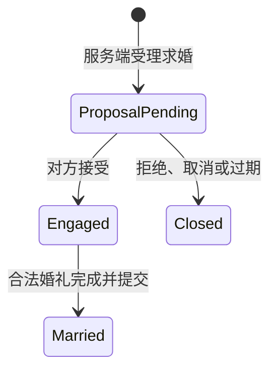

# 婚姻一期预设计：求婚、婚礼、持久化与恢复

日期：2026-10-16。状态：供讨论的 v0.1 预设计，允许随客户端验证调整；不是已批准实现规格，也不表示功能已实现或部署。

## 设计依据与目标

以指定 A21 客户端和当前 PVF 为准。客户端决定请求、回包、窗口与场景如何工作；PVF 决定等级、任务、婚礼档次、物品和属性规则。固定上游回放仅作比对样本，不作为关系或结算真源。来源及工件身份见[一期调查](MarriagePhase1Research-20261016.md)、[客户端专项](outputs/marriage-research-20261016/a21/a21.md)、[PVF 专项](outputs/marriage-research-20261016/pvf/pvf.md)。

一期交付玩家可以实际走完的双人闭环：**发起求婚 → 对方答复 → 完成婚前资格 → 选择并举行婚礼 → 建立真实夫妻关系 → 双方重登及服务重启后恢复**。试炼与求婚的原生先后尚未确认，这里表达服务端能力的依赖，不强迫客户端按该文本顺序操作。

一期包含求婚拒绝/取消/过期、婚前任务、必要的教堂流程、婚礼费用与奖励、初始婚姻摘要，以及下游配偶只读查询。基础戒指/爱心点只实现原生摘要与初始属性所需的部分。来宾、礼金、请柬、留言、配偶传送、戒指升级、完整离婚、非空婚房家具、仓库、树与胶囊分后续阶段；若实机表明其中某条消息是核心窗口的必需依赖，仅补其必要部分，不发送伪成功。

以下标记严格区分：**已知**表示本轮资料有直接证据；**建议**表示本服候选策略；**待查**表示不能从包名或常量推定。

## 1. 从哪个入口开始

先使用两名独立账号的 Lv30 以上角色，检查角色交互菜单、现有婚姻窗口和大司祭相关入口，定位真实 `03F0` 的构包调用链。不能因 town 中没有 NPC 就直接认定客户端无入口。

**已知：**大司祭 `20013` 在旧 Hendon Myre 资源中，但当前 town graph 未选入该地图；教堂地图与内部 NPC `20014` 存在，普通 town 列表没有教堂入口。

**接入策略：**

1. 原生菜单能够触发求婚时，先打通这条路径。
2. 婚前任务或婚礼必须通过大司祭时，再设计最小 NPC/场景接入，检查服务端与客户端看到的地图内容一致。内容变更另列清单，不能只在服务端放置一个客户端看不到的 NPC。
3. 教堂若由婚礼专用消息进入，就沿原生动态进入流程；不先恢复整座旧城镇，也不先加入客户端补丁。

第一步验收是双方能看到真实请求与答复窗口，接受、拒绝和错误返回都能解除客户端等待。

## 2. 求婚与婚前资格如何衔接

### 2.1 关系状态和仪式状态分开

建议关系状态：



`Engaged` 只表示双方同意，不算夫妻，不开放爱之摩伽陀。婚前资格未满足时留在该状态；原生 UI 如果要求先做任务再求婚，资格检查前移，关系模型不变。`Married` 对应调查报告建议中的 `Completed`，实现时统一采用一个名称。

仪式另有 `Prepared → Running → Completed`，以及取消/过期状态。取消一次仪式原则上保留双方已接受的关系和合法任务事实；是否存在原生解除订婚操作，按 action 补证后接入。

### 2.2 请求和答复

候选编排如下，正常时序仍须双端确认：

```text
发起方：CMD03F0，7B正文
  → 解析目标的线级身份，映射真实账号/角色
  → 双账号排序锁；事务内校验并保存 ProposalPending
  → 提交后向发起方发 CMD03F0 ACK（固定消费11B）
  → 向对方发 NOTI03CD（固定消费11B）

对方：CMD03F1，8B正文
  → 只允许当前求婚的接收方答复
  → 双账号排序锁；事务内由 ProposalPending 转为 Engaged 或 Closed
  → 提交后向答复方发 CMD03F1 ACK（固定消费12B）
  → 向发起方发 NOTI03CE（固定消费12B），双方刷新当前摘要
```

**已知：**请求的 action 与 outcome 有多种数字分支。**待查：**哪一组代表求婚、接受、拒绝、取消或其他步骤，以及目标 ID 是否是 WireUserId。不能把请求中的 `u32` 直接当数据库 CharacterId。

受理时检查双方等级、关系唯一性、目标身份、发起/答复权限和当前选中会话。目标解析后锁住两个账号，事务内再检查 owner 和会话 generation，防止解析与执行之间切角色。

**一期工作默认建议：**两个独立账号；双方交互时在线；每角色同时最多一个待处理或有效关系；发起求婚暂定 60 秒过期，可配置并随原生 UI 校准；接受后的关系不因短暂断线自动解除。PVF 未声明性别门，客户端却有属性比较，性别规则先列待查，不按职业外观猜性别。

### 2.3 婚前任务

使用真实 `20737/20738`，不预先标完成：

- `20737`：二人队普通地下城五次，奖励真爱考验箱；建议进度绑定双方角色与关系，重复死亡/通关事件不能重复计数。
- `20738`：前置 `20737`，提交心意娃娃；持有量统计、材料消费和任务奖励沿现有任务/交付能力。
- 谁必须完成任务、试炼搭档是否必须等于最终配偶，仍须原生窗口与任务操作确认。工作建议是双方各自完成，同一搭档累计；这是候选本服规则，不是已确认的官方规则。

新增 Wedding 专用资格/进度规则。修复普通 `001F` 受理 Wedding 时缺失的等级、前置等检查，专用入口与通用入口共用资格判定。只限制 Wedding 的补正先覆盖本期范围，其他 grade 的既有受理语义单独评估，避免顺手改变全体任务。

普通图的定义必须来自当前地下城内容分类；不把祭坛、塔、活动图或婚后 `3541` 自动当作试炼图。组队进入时记录双方身份，结算时校验本局有效参与者；是否要求双方存活/同场通关列为任务专项补证项。

## 3. 婚礼如何接入和结算

### 3.1 档次由 PVF 驱动

| 档次 | PVF 金币数值 | 附加物品 | 对应礼包 |
|---|---:|---|---|
| 普通 | 500,000 | 未声明豪华订制函 | `10002629` |
| 高级 | 2,000,000 | 未声明豪华订制函 | `10002630` |
| 豪华 | 0 | `2683401 ×1` | `10002631` |

主表另有时间选择 `300/600/900`。请求两个 UI 选择值均不大于 2，但它们与档次/时间的具体对应尚未确认。tuple 末列 `10/20/30` 不命名为时长或宾客数。费用承担者、每人还是每场收费、礼包每人还是每场发放同样待查；关系结算支持按参与者明确费用和奖励，不从数字所在位置猜答案。

### 3.2 场景与完成条件

先接选择/确认，再接 `03F7` 进入仪式及 `03D4/03D7` 场景通知。服务器保存自己的仪式 ID、阶段、开始/截止时间和轮次；线上的字段只在含义确认后映射。

**完成触发是实施前的关键补证点：**可能是某个请求 action、客户端确认与服务器计时组合，或者纯服务器到时推进。`WEDDING_ENTER_CEREMONY` 和 `WEDDING_CEREMONY_BEGIN` 的名称不证明“进入即结婚”或“开始即完成”。必须追踪 manager、UI/script 调用和时间分支，找到可重复的正常结束路径。

只允许服务器认可的仪式、当前双方和有效阶段完成婚礼。客户端不能直接报一个角色 ID 就把关系改为已婚；旧仪式的回包/计时任务不能完成重开的新仪式。

### 3.3 事务边界

一期先按一个明确结算点设计，具体绑在哪个原生动作上待查：

1. 开场前检查等级、关系、任务、金币/票据、档次和双方会话。
2. 到合法最终结算点后，复用 `IMultiAccountCommand`，稳定锁住两个账号。
3. 同一 SQLite 事务中重读资格、消费费用/票据、写双方奖励凭据、完成仪式、把关系改为 `Married`、记录领域事件。
4. 提交后才发成功 ACK、对方通知及双方权威摘要；费用或奖励失败，整个结算回滚。

**建议默认把费用和奖励放在最终结算事务。** 开场预检不等于预留资产，最终仍要重检；中途花掉金币可能导致结算失败，须有原生错误与退出路径。如果客户端验证要求开场时付费，则改为显式支付凭据与中止退款事务，不能通过“先扣钱，失败后尽力补回”临时拼接。收费时点在实现婚礼前确定，当前不建设未经需要证明的通用资产预留系统。

奖励使用带关系/仪式/角色唯一键的交付记录。入包或邮件按明确的交付策略处理，客户端奖励展示需要实测；礼包开启继续走已建立的物品效果与库存同步路径，不另造一条修改库存的捷径。若决定双方各一份礼包，需在设计修订中说明是已补证规则还是本服选择。

### 3.4 双人 effect 的接缝

当前 effect 操作只捕获一个主收件人，其 `Session/AccountId/CharacterId` 必须一致。不能为了双人婚礼取消这条保护，也不能各建一个 context 就认为已支持双人重放。

需要有界的双人结算编排：一个数据库事务结算双方资产，一份持久业务结果记录关系与仪式，两份收件人投影分别记录资产变化和会话。主请求 ACK 重放和对方状态刷新分开。优先复用现有资产验证/变更能力；若必须扩展 effect 管线，仅增加显式多收件人模型，并验证原单人契约不退化。

## 4. 持久化模型与幂等

建议最小表族如下，名称为预设计候选：

| 表/记录 | 保存什么 | 关键约束 |
|---|---|---|
| `marriage_relation` | 关系 ID、状态、双方规范化 pair、版本、发起/接受/完成时间、待答复到期时间 | 同一有效 pair 不能重复；状态/版本条件更新 |
| `marriage_participant` | 关系、角色、账号、发起/接收角色、是否占用有效关系名额 | 对有效参与者的 CharacterId 建唯一约束，阻止单角色跨关系多婚 |
| `marriage_ceremony` | 关系、仪式 ID/轮次、档次、时间、阶段、结算 ID | 一次有效仪式；完成只能提交一次 |
| `marriage_trial_progress` | 角色、试炼搭档/关系、任务、累计次数 | 与持有任务状态一致；通关事实有去重键，不能仅累计内存数 |
| `marriage_settlement` / delivery | 费用和奖励来源、参与者、交付方式、结算结果 | 按结算 ID/角色/奖励种类唯一，重复操作不重复消费或发奖 |

初始戒指等级、爱心点若确为关系共享，就进入关系快照；若 A21/PVF 证据显示角色独立则放参与者记录，不预先把字段存到两份独立装备中。尚未实现的成长功能不填虚构进度。

数据层以持久 CharacterId 为主；账号用来鉴权和加锁；WireUserId、connection ID、generation 只参与当前交互和投影，不作为永久配偶身份。

配偶名字从角色当前资料查询，改名不改变关系。角色删除需要一并门控：一期建议有效订婚/已婚期间拒绝删除，待答复关系可先合法取消；不能让外键级联只删除一方而留下另一方已婚。解除限制须走明确的关系终止流程，不用删除数据库行代替离婚。持久截止时间使用 UTC 与注入时钟，重启后按同一规则判定。

A21 请求没有已确认的业务 request ID。服务端生成操作/关系/仪式 ID，以当前交互上下文、exact session、状态与版本做去重；不把 TCP seq 或原始 body hash 当永久业务幂等键。相同包体未来可能是一次合法的新求婚。

费用和奖励的最终防线是持久结算唯一键与条件更新。接收方只能接受属于自己的当前求婚；同一个角色被两人同时求婚时，数据库唯一约束决定最多一个成功。

领域接口位于 Abstractions，关系/规则编排位于 Application，PVF 读取位于 Infrastructure，SQLite 与迁移位于 Persistence，协议切片位于 Protocol。业务服务问规则服务，不由 handler 直接读取 PVF。

## 5. 重登、断线与通知恢复

增加一个统一的婚姻快照查询/投影入口。登录、选角、完整角色状态、关系变化、回城等需要同步的路径共用同一份持久事实，避免“在线不刷新，重登才恢复”。实际需要在哪些生命周期发送由实机确定，不无条件重放全套固定包。

| 持久状态 | 重登/恢复行为建议 |
|---|---|
| 无关系 | 投影明确未婚状态，清除上个角色留下的客户端摘要 |
| 待答复且未过期 | 查询当前真实对方；只有原生 UI 支持恢复时才重建提示，不能重发陈旧归档字节 |
| 待答复已过期 | 事务内标记终止并释放名额；同一规则也用于下一次操作和恢复扫描 |
| 已接受、未办婚礼 | 恢复双方绑定和合法任务进度；不重复弹“新求婚”，不直接算夫妻 |
| 仪式中断 | 保留仪式/结算事实；不自动结婚。能续则恢复，不能续则关闭旧轮次并允许合法重开，不重复扣费 |
| 已婚 | 从同一关系生成双方配偶、戒指/爱心点等必要摘要；服务重启不改变婚姻事实 |

**消息候选：**`03D0 WEDDING_INFO`、`CMD03F3 WEDDING_CHARAC`、`03DD COUPLE_SIMPLE_INFO`，以及必要的戒指/爱心点消息。前两者的上游回放顺序不当作 A21 已婚重登真相；`03F3` 旧机器记录还混入 A12 开盒含义，必须重新核对。

`03D8` 先从旧彩票投影中分离，继续使用既有实帧的 204 零空婚房兼容体。完整非空家具与 13B tail 另查；不能用空婚房清掉已婚关系，也不发送上游的固定家具常量。

提交后领域事件只携带业务 ID/版本及所需事实，投递时读取当前状态并检查接收会话，避免延迟事件把新状态覆盖成旧求婚。通知失败不撤销已经提交的夫妻关系，在线重试/下一次快照恢复补齐。

服务重启恢复过期求婚与未完成仪式扫描，按持久截止时间处理；不把所有 Pending/Running 盲目标成功，也不只依赖内存 timer。初版可采用恢复扫描加操作时惰性过期，后台 sweep 按实际需要补齐。

## 6. 必须补查的协议与顺序

下表的长度是**正文**。只有此次专门复核过的长度可用于 codec；其他机器区数字仍可能包含总帧或混入旧版本含义，不能一律减 14。

| 优先级 | 消息 | 已知 | 必须补查 / 解锁哪一步 |
|---|---|---|---|
| P0-求婚 | C2S/CMD `03F0`、NOTI `03CD` | 请求7B、CMD消费11B、NOTI消费11B | ID 对象身份、action1/2/5/6/7、尾字段、错误码、真正 UI 入口 |
| P0-答复 | C2S/CMD `03F1`、NOTI `03CE` | 请求8B、双方接收各12B | outcome0/1/2、接受/拒绝按钮映射、取消/过期关闭方式、通知顺序 |
| P0-资格 | `001F/0022` 与 Wedding subtype22 相关路径 | 通用受理/完成已存在；任务真实存在 | 婚姻 UI 怎样接取任务、双方完成要求、搭档绑定、通关计数与触发 |
| P0-婚礼 | `03F0` 相关后续 action、C2S/CMD `03F7`、NOTI `03D4/03D7` | 03F7请求9B/回包4B；通知消费79/68B | 档次/时间映射、教堂进入、名字编码/身份顺序、开始/结束时点、合法完成触发、掉线退出 |
| P0-恢复 | NOTI `03D0`、C2S/CMD `03F3`、NOTI `03DD` | 03D0消费15B；03F3/03DD仅已有静态线索 | 关系/阶段/配偶字段、查询与推送区别、未婚和已婚差分、完整长度及必要顺序 |
| P0-隔离 | NOTI `03D8` | 消费17+6n；204零已有入场样本 | 切断非空旧彩票发送；空婚房回归；13B tail 不猜填 |
| 条件依赖 | NOTI `03CF/03D1/03D3`；C2S `03F5` | 分别有装扮、戒指、爱心点命名与静态记录 | 完成婚礼/重登是否必需；礼包中爱心点道具是否需专用入口；确认后才扩大一期最小接入 |
| 后续 | `03F2/03F6`、NOTI `03D5/03D6` | 礼金、请柬、宾客候选 | 如核心仪式无需它们，暂缓完整流程 |
| 后续 | `03F8..0406`、NOTI `03D2/03D9..03DC/03DE..03E0` | 留言、传送、婚房/仓库/树/胶囊、离婚等候选 | 按对应后续功能独立补证；一期遇到请求不得静默挂起或伪成功 |

探针操作顺序：未婚登录 → 同场求婚 → 分别点两个答复按钮 → 接受后查看任务/婚礼选择 → 进入/开始/正常结束 → 中途退出 → 双方分别重登与换角色 → 服务重启恢复。双端都归档明文帧并记录可见结果。

对无法由当前服务端正常返回引出的后续帧，先做定向静态追踪或可回滚的服务端探针。探针与真实持久结算分开，未知流程不发放真实奖励、不授予 Married；不得用临时伪状态的成功现象冒充业务验收。

## 7. 边做边改的实施切分

| 小步 | 交付与验收 | 此步允许修订的内容 |
|---|---|---|
| A 原生入口与协议探针 | 两端能发请求、看到邀请、接受或拒绝，错误能退出等待；确认完成触发的调查方向 | action/outcome、ID、错误码；是否需要 NPC/内容变更 |
| B 持久求婚与试炼 | 真实关系约束、双方资格、任务进度、重登恢复，拒绝重复/错误对象 | 试炼与求婚先后、搭档绑定、超时与离线策略 |
| C 正常婚礼 | 档次选择、教堂/仪式、费用、礼包、双方 Married 与摘要正常 | 原生收费/发奖时点、时间字段、最低戒指/爱心点消息 |
| D 恢复与失败矩阵 | 断线、切角色、重复包、费用不足、事务失败、重启，不单边结婚、不重复结算 | 恢复投影与必要的 effect 扩展 |

每一步补证后更新本设计及对应协议人工区，保留版本差异和证据等级；领域状态与线级 action 之间用适配层映射，避免一个新枚举发现迫使重写数据库。

代码测试重点是关系唯一性、并发答复、资格拒绝、试炼去重、结算回滚、奖励幂等、旧仪式拒绝和重启恢复。协议用真实向量验证长短包和字段顺序。最终必须双端确认双方配偶显示、仪式完成与重登恢复；单端不报错不等于通过。

爱之摩伽陀只读查询返回真实 Married 关系、双方角色 ID 与版本；订婚/试炼状态不算夫妻。该接口准备好不表示 `3541` 已完成，也不提前启动其准入/地图实现。

## 本轮交付边界

本轮只交付预设计，没有实现、迁移数据库、改 PVF/客户端或部署服务。以上策略是可修订建议，不将 Unknown 填成原服事实。进入实现时先完成 A，再依据证据冻结下一小步；无需等婚房、宾客等全部协议查完才推进核心闭环。
