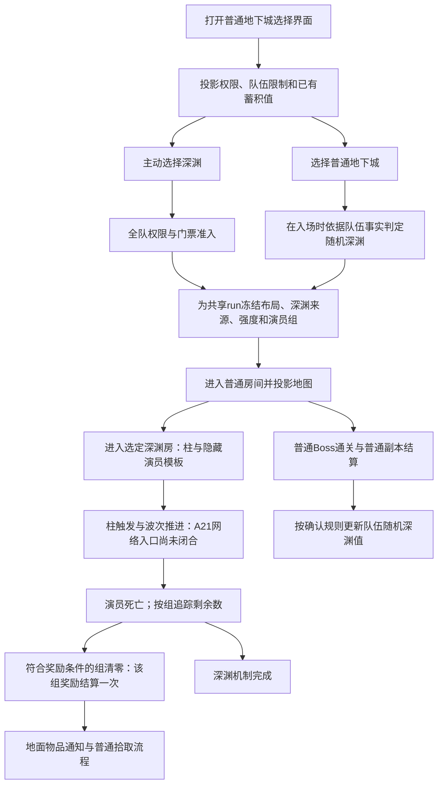

# 深渊模式：前置信息探索

日期：2026-10-07。研究工作区：`.worktrees/abyss-research`，分支`task/abyss-research`。
JP86基线：`81f4373f8e5d686257420080b3f1b0c7cc7fc83c`。

用户授权：新建工作区，使用多个子代理探索70服务端、上游与客户端；覆盖深渊触发、进入、随机出现、掉落计算、协议语义与可能的服务端处理方式。探索之后再讨论实现。

本轮只改变研究资料和有直接证据支撑的协议说明。没有实现深渊、部署服务器、修改玩家数据库、替换客户端/PVF，也没有提升版本或推送远端。

## 阅读顺序

1. 本页：跨来源结论、流程、关键差异及实现前缺口。
2. [当前实现](current-implementation.md)：JP86已经具备哪些可复用能力、还缺什么。
3. [70参考](70-reference.md)：原生函数、随机深渊蓄积/概率及掉落调用路径。
4. [上游与PVF](upstream.md)：已实现链路、硬编码/遗漏与本地资源实读。
5. [客户端](client.md)：A21静态构包/解包、UI状态与协议身份。
6. `evidence/`：可复现探针、定位身份、反汇编节选与PVF只读输出；大型临时工件留在本工作区的`artifacts/`。

## 证据如何使用

| 标记 | 能支持什么 | 不能据此声称什么 |
|---|---|---|
| `70Reference` | 指定哈希的70二进制如何判定、累计、抽取、发送 | A21编号/布局相同或JP86已实现 |
| `UpstreamImplementation` | 指定commit与工作区中的代码怎么做 | 原版官方算法、A21客户端已接受 |
| `PVFContent` | 当前PVF确实声明哪些数据 | 消费者实际按什么分母/顺序解释、整局真实爆率 |
| `ClientStatic` | 指定客户端函数读写哪些字节、调用哪些UI路径 | 真实收发发生时序与实机操作结果 |
| `CurrentImplementation` | JP86当前代码的接入与缺口 | 原版客户端业务语义正确 |
| `WireCaptured/ClientVerified` | 对应样本与操作范围内的线级/实机事实 | 本轮没有进行深渊实机验证，不扩大普通地下城历史验收范围 |

每条主张另外区分`Confirmed / High / Hypothesis / Unknown`；“Confirmed”仍然只属于声明的证据来源。

## 当前可确定的方向

- 主动深渊和随机深渊是不同的准入来源；普通地下城难度、深渊强度和深渊演员组也不能混成一个枚举。
- JP86只有普通副本的入场、房间、死亡、物件及掉落基础；深渊请求状态没有流入领域事实，地图投影固定关闭，专属掉落为空。
- 70参考存在队伍随机深渊值的累积、门槛与随机判定。上游读取了相关PVF声明，却没有消费这条随机触发链，不能整套移植后宣称支持随机深渊。
- 深渊爆率需要分别看：奖励触发点、尝试次数、装备命中率、稀有度、等级/物品池和碎片。PVF某组的史诗0.7%不能直接描述为“一局0.7%”。
- 协议旧注释存在跨版本身份/布局混用；应按客户端实际注册与消费重新对账，不按名字或整体位移推算。

## 玩家流程与服务端时机

以下是根据三路证据重建的**候选流程**，不是本轮新抓到的完整时序；箭头表示业务依赖，不声明所有包的严格先后。



这里的“组奖励一次”与“整个深渊只结算一次”不是同一件事。70有组剩余计数；上游按合资格组的最后一名演员发整组装备/碎片奖励。普通怪、带`[hell monster]`标记的演员、APC、奖励组及普通Boss应分别建模，不能每杀一个演员就发一份完整深渊奖励。

深渊清场和普通地下城通关也是两个事件。上游仍使用普通通关经验/翻牌；没找到“深渊完成另发一份史诗”的依据。中途返回、跳过深渊、先打Boss、多人末杀竞争与重访必须单独验证。

## 主动深渊与随机深渊

| 维度 | 主动深渊 | 随机深渊 |
|---|---|---|
| 准入来源 | 玩家选图状态；区域/任务/有效深渊房；门票或通行证 | 普通副本入口的随机遭遇决策；70使用队伍蓄积值、人数与条件 |
| 消耗 | 上游检查每名成员门票；数量公式为代码定义，PVF提供票ID | 不能把主动门票扣除复制到随机遭遇；本轮尚未证实所有费用细节 |
| 判定时机 | 入场命令；选图查询只是展示 | 70在入场路径判定，通关路径累积；不是打开UI时重新抽 |
| 数据 | WDM权限/票、DGN封印门和MAP组声明、hellparty难度表 | hellparty基本值、队伍事实；randomhell的等级/组声明是另一个内容来源 |
| 上游覆盖 | 已有，但存在硬编码与客户端错位 | 基本值和randomhell未被实际触发链消费 |
| 客户端证据 | CMD0010本地15B序列已读；偏移5/6还不能仅按上游名字解释成bool | NOTI00CF读取u32并在队伍人数<=1时清0；这不证明所有单人随机机制不存在 |

70参考的随机判定包含`trunc(V) >= get_rand_int(100)`以及最低门槛。这里的`get_rand_int`与掉落MT不是同一wrapper，分布/边界未完整闭合，不能将参数100直接解释成`V/100`的严格概率。主动和随机入场都调用值消耗；其实际操作是乘保留比例，再应用最低值，而不是简单归零。

通关累积的70公式是`V += rising × levelRate × (1 + difficultyRate + ancientRate + partyRate)`；rate在脚本导入后除以10000，等级差桶、人数和排除条件见[70报告](70-reference.md)。上限比较先截断，不能无条件简写为浮点`min`。70的00CF发送`trunc(V×100/cap)`；A21只确认读取u32，单位仍需对齐。全部初始化、队伍变更和持久化行为仍未闭合。把70公式迁到A21属于后续设计选择，不是版本一致性证明。

当前PVF的随机基础值声明：上限100、下限1、base1、rising5、等级差率`10000/5000/2000`、普通难度率`2000/4500/6800/6800/6800`、队伍率`0/1800/4000/8000`、远古附加8500、引导线63。**PVF给出值，不自动给出分母、调用时机或重置所有权。**70指令与标签解析共同决定其可解释范围，上游没有使用整段数据。

## 三种难度不要混用

1. 普通地下城难度：A21 CMD0010的普通入口参数0..4，影响深渊装备命中轴和碎片次数（后者仅为上游现状）。
2. 深渊强度：hellparty的A/B/C/D行；上游常用A/B，且普通选图字段、START_MAP模式字节如何映射仍需A21实测。
3. 波次/演员组：MAP的`groupId,rate,order`与hellparty的组→演员定义；order只是顺序分组，不能把一行中的所有候选都同时刷出来。

70的难度选择分别消费`[difficulty]`第3整数（随机）和第4整数（主动）。当前PVF A/B两列分别为3:97与60:40；上游主动选择使用后者，前者只存不消费。两种来源不能共享一列默认权重。

例如PVF中的Watchtower190：最低等级85、basis88，明确普通封印房60078位于`(3,3)`，季节房91009位于`(3,1)`；不能用相似`hell_...`文件名推翻DGN关联。WDM Castle32配置前置任务2002、普通票3330及多种freepass。上游按其代码公式需要26张普通票，这不是本轮确认的官方费用。

70普通票数量也使用同形公式，免费券优先且按队员扣除；其函数内没有闭合跨队员原子回滚，删除失败有日志后继续。该参考只能解释行为来源，不能据此要求新服务复制部分扣费风险；A21费用仍需实测。

## 掉率计算需要拆开

基本表达式为：

```text
某组一次roll命中特定装备
  = 装备门命中 × 稀有度命中 × 当前等级/来源下的物品池权重占比

该组至少一件史诗（各轮近似独立、史诗池有效时的示意）
  = 1 - (1 - 单轮装备门命中 × 条件史诗率) ^ 尝试次数
```

真正实现还必须处理整数区间、稀有度累积边界、池为空、重复候选、等级范围、药剂、随机流和多奖励组。上式只是解释各概率层的关系，不是实际LCG/MT联合分布证明。

| 环节 | 70参考 | 当前上游/PVF | 必须避免的误读 |
|---|---|---|---|
| 奖励时机 | 深渊组计数清零，最终完成另有状态 | 组末只且末只没有`[hell monster]`标记时发整组奖励 | 任意一只怪都发整组；整个图只发一组 |
| 尝试次数 | 从脚本难度字段进入演员再进入drop上下文 | PVF A8/B6被上游作为组装备roll数消费 | 所有深渊永远固定9件 |
| 装备命中 | 普通难度/等级段与倍率组合，含端点随机比较 | rate`335/875/1000/1400/1000`；倍率固定100；N/E名义命中约33.57%/87.51%，其余饱和 | 表的335直接当33.5%；忽略包含0的区间 |
| 稀有度 | 独立稀有度抽样；原生随机区间与上游不完全同形 | 上游A条件史诗名义0.7%，B为0；原始末阈值超过百万 | 0.7%就是整局率；超基数的阈值可忽略 |
| 装备ID | 等级/rarity候选后按creation rate选择 | 上游从equipment.lst分桶；实际用minimum..basis+7，已读参考表未被使用 | 上游池就是官方池；人人同等级就必然同掉落列表 |
| 史诗药 | 需按版本分别核对 | 上游初次非史诗时再抽rarity，仅第二次史诗才覆盖 | 直接将总爆率乘2 |
| 碎片 | 70不能自动证明A21新增系统 | PVF710对装备→碎片映射；上游抽取次数硬编码，直接从可映射史诗池选 | 碎片必须先命中装备0.7% |

上游单个合资格A组、8次roll、有效史诗池且无药时，近似计算的至少一史诗值约为N1.864%、E4.797%、M/K/S5.465%。这是**上游算法的名义示意值**，不是官方掉率、A21实测率或多组整局总率；详见[原始算法与限定条件](upstream.md#稀有度门)。

70正常掉落路径的两个MT分别取`0..1000`和`0..1000000`，都包含0与上界；上游稀有度LCG则取`1..1000000`，不能视为同一分布。70还由Luck和队伍重叠率调整稀有度阈值，并实际消费装备等级参考窗口（上界排除）；上游已读此表却使用另一固定范围。这些差异会影响真实掉率，不能仅复制PVF数字。

## A21协议结论及不能照抄的旧映射

| 消息 | 本轮结论 | 边界 |
|---|---|---|
| CMD0010 | 普通入口本地15B；偏移5为moduleMode、6为derivedMode | 不直接当两个bool，也不宣布所有特殊分支均15B |
| NOTI001B/001C/001D | 选图/地下城/房间主链；上游会携带深渊权限、布局、隐藏演员及模式 | 当前深渊字段含义、模式实值和严格顺序仍需A21消费/实测对齐 |
| NOTI00CF | 读取u32，队伍人数<=1清0 | 蓄积单位、概率与更新时机不是客户端读取长度能证明的 |
| NOTI02A7 | 读取`u32 count + n×(u32 hellIndex,u32 level)`，日志确认索引/等级 | **不是旧文档中的重连PartyId；index不能未经映射确认改名monsterCode** |
| NOTI030E | handler不读正文，触发事件0x27 | 本地消费0B，不证明原服务端wire一定无尾部或最终UI表现 |
| CMD0413 | 活动开关本地raw18B，+14为u32；success响应再读三个u32 | 上游body[13]开关与无ACK做法有差异；raw18与最终wire关系尚未闭合 |
| NOTI0431 | 读取8B，两标量写booster对象 | 单位与上限未知 |
| NOTI049C/CMD04C3 | UI信息固定读取32B；选择请求逐勾选项提交raw18B | 业务字段、index含义与最终wire未知 |
| CMD00E4/00EB | A21原生命令名称表及构包指向公会驻地/拆解 | 不能复制70编号或上游同号分流作为A21深渊开始协议 |

已将有直接A21证据的裁决写回相关`protocol/game`人工区，并修正02A7/00EB的错误生成含义输入及相关索引。没有为了实现方便伪造一个专用start包或发送未确认的字段。

## 建议的服务端处理边界（供下一阶段讨论）

- 以现有共享`DungeonRun`为世界真源，附加深渊机制状态；避免另建一份玩家、队伍、怪物和地面物品副本。
- 深渊领域服务管理准入来源、遭遇决策、柱/波次/组状态和完成结果；深渊规则服务读取PVF并接收显式事实、种子，返回规则决定。HTTP/协议handler只调用领域能力。
- 随机蓄积归属需明确为队伍状态及其生命周期；是否跨重启持久化、换人/解散如何处理，是待选择的产品语义。不要因客户端显示u32就新增每角色余额表。
- 权限查询、配置查询、当前机制查询都保持read-only。抽取只发生在明确的入场/奖励变更入口，重发通知或打开UI不重新抽、不扣票、不补发奖励。
- 全队门票/疲劳、冻结选择与run发布复用现有事务边界；失败不能留下部分成员已扣票、另一些成员另开一局。
- 按`run + 深渊房 + 奖励组/批次`管理一次性奖励结果；死亡报告、重访、断线恢复不能重复发整组奖励。
- 地面身份、归属、拾取和库存由现有物品/副本系统负责；深渊只决定生成的奖励，不自行另写一个发物品系统。
- 通知投影对应已发生的领域变化；CMD查询不会变成清场/奖励补结算入口。

## 实现前的优先缺口

1. **柱触发链**：A21从破柱/脚本到网络的实际入口，是否普通物件死亡/本地阶段推进；目前没有确认专用start opcode。
2. **主动选图和房间字段**：CMD0010状态值、NOTI001B限制列表、001C深渊房坐标及001D模式/隐藏演员如何驱动本客户端。
3. **随机遭遇完整生命周期**：70参数映射/重置、A21对应事实、队伍换人/解散、入口失败是否消费蓄积。
4. **奖励来源与边界**：组末杀资格、等级池、含端点稀有度、特定物品分支、史诗碎片/药剂及个人/共享掉落。
5. **多人/重访**：已死演员与group计数恢复、回城/重进收费、Boss清场不误删深渊、过期run消息隔离。

下一阶段可以先选“一个有效地区的主动深渊”完成最小实机证据链，再决定规则适配与随机深渊范围。本轮研究已经覆盖这些问题的代码与静态证据，但**未完成深渊WireCaptured/ClientVerified**；当前未知项应成为实现前的验证项，不能被默认值掩盖。

## 交付检查

- 70、上游、客户端三路调查完成，并对总览/当前实现/协议资料进行了交叉审查；发现的02A6/02A7来源错位已修复，指定修复复审通过。
- 研究文件72个，约2.55MB，均为文本；UTF-8、Python语法、JSON、本地链接及5个来源文件的长度/SHA256检查通过。证据输出统一为UTF-8/LF并去除行尾排版空格，便于版本比较。
- `git diff --check`及`check-server-documentation-sync.py --repo-root .`通过；后者检查127个C2S身份、187个S2C身份，failures=0。
- 差异只涉及研究资料、只读证据探针和协议文档/生成输入。主工作区保持原main基线，上游已有未跟踪备份保留；生产代码及运行资源未变。
