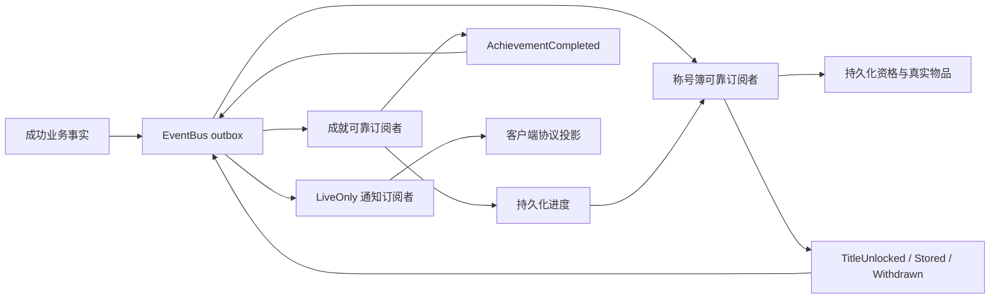

# 成就与称号簿实现说明

## 职责与信息流

成就服务不授予称号；称号簿不改变成就进度。两者各自使用存储接缝，称号簿读取已持久化完成事实。数据库没有主动回调。发布、消费和其产生的新事实进入同一事务；失败重试不会重复累计或发物品。通知是在线尽力投递，离线状态由再次登录同步恢复。

业务模块发布强类型通用事实，不携带成就或称号ID：确认后的击杀/最终Boss通关、任务结算成功、普通物品使用、统一材料服务扣除成功、等级变化。击杀/通关从已确认的 canonical kill 命令发布；不会按客户端重复死亡报告再计数。APC不计普通 huntmonster。

## PVF与当前支持范围

成就从 `n_quest/quest.lst` 中 grade=title/achievement 的任务动态读取；称号目录来自 `etc/titlebook.etc`。当前档案共719条，支持85条：击杀14、任务/成就依赖65、物品使用5、通关条件子类型6一条；其余634条保持未支持。完整统计见 achievement-final.log。五分类容量为80/170/50/100/100；事件分类开放槽的 `-1` 允许任意永久称号。

已实现：单目标 huntmonster、clearquest（同时支持成就依赖链）、单物品且单位消耗的 useitem、单目标 condition-under-clear 子类型6。等级门槛有效，先决任务组遵循组间OR/组内AND。职业、转职、问答、冲突任务等暂未实现的限制，以及多目标/评分/PVP/点击/塔层等条件保持未支持，不采信任意客户端delta补完。u16表达范围外的计数也不自动完成。

`MaterialConsumed` 当前来自统一材料消耗服务，普通使用另发 `ItemUsed`，同一次普通使用不会重复经过材料服务。尚未具备事实生产入口的操作不会伪造进度。后续扩展一个条件时，同时补业务事实及其PVF匹配测试。

## 持久化和存取

沿用 `character_achievement_complete` 的剩余计数；新增已消费事实记录和永久称号资格。称号实物沿用 `items/item_slots` 的五个角色容器19–23。称号移出不会撤销资格，也不会在重登时重新授予。旧背包/装备中已有允许称号时保留原物品实例；不覆盖不相容的旧书槽物品。

存取使用 BusinessSlot，经规则服务验证称号类型、允许槽、永久性、锁、容量及资格。主背包存入可交换；装备存入不得覆盖书槽；取出目标必须为空；任务称号取出到实际称号装备位并经过普通装备资格检查。移动完整物品实例，不重建强化/附魔/增幅属性。

CMD确认负责结束客户端请求。NOTI由事件订阅者触发。成就请求和称号存取共用一个仅用于协议投递的短暂角色门，保证CMD先于异步权威刷新；该门不参与可靠领域消费，不持有写事务等待网络。

## 查询与登录

`GetAsync` 和 `01A8` 查看只读取状态，不补结算或授奖。他人查看限定同频道且当前在线的目标会话。登录有独立显式准备阶段，初始化新进度、按已完成持久化事实兼容旧资格，随后以现有登录同步发送状态。

## 证据边界

协议静态和上游参照见 [protocol-evidence.md](protocol-evidence.md)。尤其0166非空条目的22B前缀已静态定位，随后helper虚拟化，额外4B取自上游实现，仍待实机确认。自动化通过不代表 ClientVerified；不修改客户端/PVF。

普通任务受理与结算拒绝 grade=title/achievement；已有旧任务簿记录也不能从普通结算入口再次授予称号。真实PVF的4303/6501通过拒绝回归验证。
