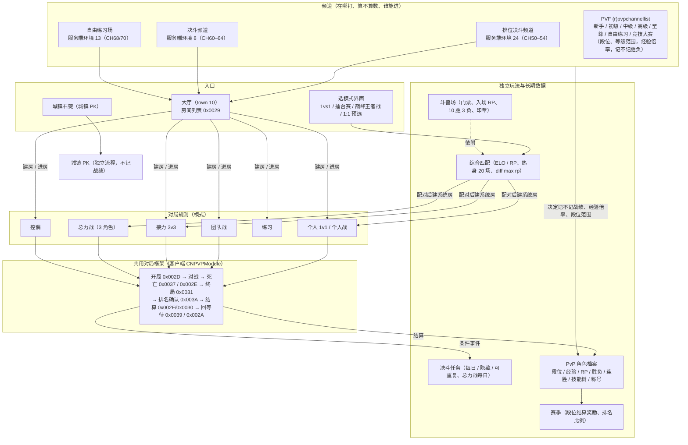

# PK 系统总览（A21）

2026-11-15 调研结论，供重新设计决斗场使用。只记录事实、证据与方向，不含实现方案。

证据标签：**PVF**（A21 dev PVF `a97132dd…` 直接读到）、**ClientStatic**（b1 客户端镜像小范围反汇编或已有 unit 文档，镜像 VA，ImageBase 0x400000）、**70Ref**（70 官方服务端 `df_game_r` 按函数反汇编）、**Upstream**（ServerS4A21 实现与 `Docs/决斗场业务实现.md`）、**ThirdParty**（第三方商业端反编译源码）、**Live**（本仓测试服实测）。置信度 Confirmed / High / Hypothesis。

主要原始资料：

- PVF：`PvfBuilds/revised-20261114/Script.pvf`（dev 通道 `content:0.3.3-dev.1`），各文件路径见各节。
- 客户端：`DNF-JP-86-ClientHack/Docs/a21-units/unit-007.md`（CNPVPModule）、`unit-033.md`（CNPVPRoom）。
- 70：`Research/1995chen-dnf/other/等级补丁/70/df_game_r`；本任务 `research.md` §1.1。
- 上游与第三方：本任务 `research.md` §1.2。

---

## 1. 结论速览

1. **A21 的 PK 主线是"选模式 + 综合匹配"，不是自由房间。**
   - 客户端选模式界面 `clientonly/pvpselectmodeui/pvpselectmodeui.co` 只有 4 项：1vs1、擂台赛（接力 3v3）、巅峰王者战（总力战）、1:1 预选。PVF，Confirmed。
   - `etc/matchingmode.etc` 按 gametype 定义匹配人数、阵营与 ELO/RP 参数。PVF，Confirmed。
   - 本仓一期做的是 70 / 上游式的"自由房间"（建房、进房、房主开局），它在 A21 仍然存在（频道选择 → 大厅 → 房间列表），但只是 PK 的一部分。
2. **频道的环境值 8 / 13 / 24 不来自 PVF。**
   - 来自服务端自带的 `Server/src/Dfo.Server.Host/Resources/Channel/channel_info.etc`（上游沿用）。PVF 自己的 `channel_info.etc` 是国服格式，决斗类型为 4 / 5 / 6；`etc/(r)pvpchannellist.etc` 另有一套按段位分档的频道表。三套口径不一致，需要裁定。
   - 客户端对环境值有硬编码分支：环境 8 走完整的加载与 P2P 连通链；24 / 13 直接进入对战。ClientStatic，Confirmed，见 §5。
3. **战斗内数值几乎全部由客户端读 PVF 处理**：技能 `[pvp]` 段、PvP 均衡与上限、装备 PvP 修正、连击减伤、死斗倍率等。服务端负责的是**流程、判胜、积分、奖励、限制**。
4. **段位刻度存在两套**：`pvp_ref.etc` 是 0–20（21 档）；频道表与决斗任务按 0–29 / 30。PVF，Confirmed；原因待查。

---

## 2. PK 有哪些模式与玩法

### 2.1 三个维度

| 维度 | 是什么 | 例子 |
|---|---|---|
| **频道** | 在哪里打、算不算数、谁能进 | 新手 / 初级 / 中级 / 高级 / 至尊决斗场、自由练习场、竞技大赛频道 |
| **对局规则（房间 / 匹配的模式）** | 一局怎么分队、怎么判胜、多久 | 个人 1v1、团队、个人乱斗、接力、死斗、练习、总力战、控偶、僵尸 |
| **独立玩法** | 自己的入口、队列、门票、赛季、奖励 | 综合匹配排位、斗兽场、总力战编队、赛季结算、决斗任务、最强者战、锦标赛预选、城镇 PK |

### 2.2 模式清单

| 模式 | 客户端支持 | 入口 | A21 是否开放 | 70 | 上游 / 第三方 | 本仓 |
|---|---|---|---|---|---|---|
| 自由房间：个人战（模式 1） | 完整（房间协议族、状态机） | 决斗频道 → 大厅 → 建房 | 是（频道选择框存在） | 有 | 上游有 | 一期已做 |
| 自由房间：团队战（模式 2） | 完整 | 同上 | 是 | 有 | 上游有 | 一期已做 |
| 接力 / 擂台赛（模式 3，3v3） | 完整：专属状态 PREPARE_RELAY_BATTLE、RELAY_FIRST_COUNT；C `0x0070`、S `0x0070`/`0x0071` | 房间选模式；选模式界面"擂台赛" | 是（选模式界面有） | 有（`CRelayBattleMgr`） | 上游半成品，第三方较完整 | 无 |
| 死斗（模式 4 / 5） | 只改伤害倍率（`pvp deathmatch attack power rate` 1.8） | 无 | **否**：只在 `data/extern.sd`，地图 50019/50043/50044 不在 `map.lst`，matchingmode 无 deathmatch。PVF，High | 有 | 无 | 无 |
| 练习（模式 6 / 房间特殊值） | 状态 PREPARE_PRACTICE、TRAINING；本地 AI 与连招题 | 外部调用 vt+0x194（入口未追到） | 待查 | — | 上游吞掉 | 无 |
| 控偶（模式 7） | 专属状态 PREPARE_DOLLMODE / SELECT_DOLL / COMPLETE_MAKE_DOLLS；C `0x0272`–`0x0275`、S `0x022B`/`0x022C` | 选模式界面无条目 | 存疑：`[pvp event] fight doll on`，但入口未证 | 无 | 无 | 无 |
| 总力战 / 巅峰王者战（模式 8，3 角色编队） | 专属状态 TOTAL_MATCH 系列；C `0x035E`–`0x0361`、S `0x031D`–`0x0321` | 选模式界面"巅峰王者战" | 是 | 无 | 上游只有编队 | 无 |
| 综合匹配 1v1 / 接力 / 总力战 / 预选 | C `0x0209`–`0x020B`、`0x023B`–`0x023D`；S `0x01CD`、`0x01CE`、`0x01F8`–`0x01FE` | 选模式界面 | 是 | 有（联赛匹配 `CLeagueMatch`） | 第三方有 | 无 |
| 个人乱斗（individual，3–4 人）、团队 2v2 | matchingmode 有定义 | 选模式界面无 | Hypothesis：无入口 | — | — | — |
| 僵尸（zombie，3v3，绑频道） | `ui/pvp02/ingame/zombie` | 绑频道 | 存疑 | — | — | — |
| 斗兽场 | C `0x020F` 买票、`0x0210`、`0x02A0` 分解；S `0x0262`/`0x0263` | 匹配界面模块 | Hypothesis：依附 1v1 综合匹配（`pvpcolosseum.etc` 有入场 RP 800、10 胜 3 负、奖励表） | 无 | 第三方有 | 无 |
| 公平决斗 | 只有战绩查询 `0x0177` | 无入口 | High：未开放（`fairpvpstat.etc`、`fairpvpequipment.etc` 在，但频道与 matchingmode 均无） | 有 | — | 无 |
| 最强者战 | — | — | 否（`[pvp event] the strongest off`） | — | — | — |
| 锦标赛预选（preTournament 1v1） | C `0x0227`/`0x0228`；TOURNAMENT_JOIN 系列客户端无 | 选模式界面"1:1 预选" | 存疑（锦标赛参数日期为 2016） | — | — | 无 |
| 城镇 PK（Assault） | 两端齐全：REQUEST_PEER type 4、S `0x01BC`、`0x0080`–`0x0089`、C `0x0091`/`0x0093`/`0x00A7`/`0x00F4` | 右键菜单（未查） | 待实机 | 无 | 第三方有 | 无 |
| 观战（座位 3 / 4） | 房间座位模型支持 | 房间 | 是 | 有 | 上游有 | 无 |
| 录像观战 | 客户端无协议（只有本地录制，环境 8 / 13） | — | 否 | — | — | — |
| WARROOM | 刷怪区域型，建房开局协议客户端无 | — | 不归 PK（副本型阵营战） | — | — | — |

---

## 3. 模式之间的关系

组合规则（已知部分）：

- **频道决定"算不算数"**：PVF 频道说明原文写明——新手频道强化 / 增幅 / 锻造归 0、不记胜负、决斗经验为其他频道的 70%；初级以上强化增幅保留但效果低于地下城；自由练习场不记胜负、不给胜点与决斗经验。PVF，Confirmed（说明文本）。这些规则当前服务端都没有实现。
- **频道决定"谁能进"**：`(r)pvpchannellist` 每个频道有段位与等级范围；70 还对高段位进低段频道打折扣（`[pvp channel grade penalty]`，PVF 同名段存在）。
- **模式决定"怎么打"**：分队、判胜、时限（普通 180 s、接力 120 s，锦标赛 240 / 180 s），由客户端状态机在 PREPARE_BATTLE 按模式分支。ClientStatic，High。
- **匹配之上再建房**：综合匹配配对后建一间系统房，模式只是参数；斗兽场再在匹配之上加门票、入场条件与奖励（第三方实现与 PVF 参数一致，Hypothesis）。
- **所有模式共用一套结算协议**（`0x002F`/`0x0030`），积分规则因模式、频道、匹配而异。

---

## 4. PK 的独立设定

| 设定 | 数据来源 | 谁负责 |
|---|---|---|
| PvP 技能树与技能页 | PVF `pvpskilltree.lst` + `pvpskilltree/*.etc`（只有 10 个职业）、`pvpskillpoint.etc` | 服务端按频道下发独立技能档（本仓已有）；`pvpskillpoint.etc` 未接入 |
| 技能 PvP 数值 | 1521 / 3028 个 `.skl` 有 `[pvp]` 段（倍率、冷却、开局冷却）；39 个技能 `[league ban]` | 客户端 |
| 均衡与上限 | `etc/pvpparameter.etc`：修正基准 85 级、技能伤害均衡 0.75、高级技能开局冷却 0.7、召唤物 HP 均衡、`[PVP equalization]` 职业表、强化与装备修正、HP 上限 400000、攻速 / 移速 / 施放速度上限 | 客户端 |
| 硬直、连击、伤害基数 | `etc/etcparameter.etc`：连败保护、防御加成、站立连击、重力重置、`[skill damage base parameter pvp]`；`pvprevisiontable/combodamagerevisiontable.etc` 连击减伤 | 客户端 |
| 装备 PvP 修正 | 4323 个 `.equ` 有 `[revisionPvpGrade]`，673 个有 `[pvp]` 覆写；`pvpequipmentrevisiontable*.etc`；状态异常的 pvp module 缩减 | 客户端 |
| 装备 / 道具限制 | 55 个装备 `[disable pvp] 1`；`[pvp enterable character]` 可进场职业 | 客户端为主；可进场职业服务端也应校验 |
| 死斗倍率 | `data/extern.sd` `pvp deathmatch attack power rate 1.8` | 客户端（死斗无入口） |
| 段位与经验 | `pvp_ref.etc`：21 档阈值、每段胜 1000 / 负 0…-1076、满级与 loss | 服务端（本仓一期已做） |
| RP / ELO 积分 | `matchingmode.etc`：初始 RP 1000、K 值按 RP 档、连胜连败、热身 20 场、`diff max rp` | 服务端（未做） |
| 频道经验倍率与限制 | `(r)pvpchannellist` 说明文本、`serverparameter` `[pvp channel grade penalty]`、`[pvp exp penalty revision]` | 服务端（未做） |
| 每日限制与奖励 | `pvp_ref` 每日胜利奖励道具 10012664 × 5、每日上限 10；`(r)serverparameter` `[daily match count] 5` | 服务端（未做） |
| 赛季结算 | `pvp_ref` `[last season pvp reward]`（按段位发袖珍罐 10148297–10148305，NPC 325）、`[pvp rank rate]`、`[pvp rank total cnt] 1500` | 服务端（未做） |
| 热身奖励 | `pvp_ref` `[pvp warmup reward]`、`[reward item by warm up step]` | 服务端（未做） |
| 决斗任务 | `pvp_mission/*.msn`（`mission.lst` 97 条，目录里另有未登记的）、`missionsystem.etc` 总力战每日任务；`n_quest/pvp/*.qst` 每日对战任务与段位成就 | 服务端（未做；本仓只有任务列表表结构） |
| 斗兽场 | `pvpcolosseum.etc`：入场、每日购买上限、结束条件、最低入场 RP 800、奖励表；498 个装备 `[colosseum disjoint info]` | 服务端（未做） |
| 决斗场装备商店 | 195 个 `.equ` 以 `[medal]` 计价（`[item category] colosseum equipment`）；斗兽场印章 10092947 | 服务端（货币未证：Hypothesis 为胜利证明或胜点） |
| 称号 | `titleanimation/pvptitle/1–10stage.ani`、`pvpfightdolltitle` | 客户端显示；服务端发放条件未查 |
| 地图池 | `pvpmapbasicdata.etc` `[pvp map order]`（0 = 随机）、`igatable.etc` `[pvp map set]` | 服务端（本仓已做） |
| 对战时限与流程参数 | `pvp_ref` 时限；`[pvp direct wait] 5`、`[pvp timeout] 20`、`[pvp rematch] 3` | 服务端（时限已读；其余未接） |
| 公平决斗 | `fairpvpstat.etc`、`fairpvpequipment.etc` | 未开放 |
| 胜点 | PVF 没有 win point 字段 | 70 的商城货币；A21 对应物未证 |

战斗本身（伤害、HP、命中）是客户端之间 P2P 计算，服务端不参与；服务端只收死亡与超时上报判胜。70Ref、Upstream、ClientStatic 一致，High。

---

## 5. 对照一期实现

### 5.1 被证伪或缺失的假设

| 一期假设 | 实际 | 证据 |
|---|---|---|
| 开局后有加载 → P2P 连通阶段，客户端报告 `0x012A`/`0x012B` | 按频道环境分支：24 / 13 直接进对战、不发；**环境 8（CH60–64）走完整链**，发 `0x012A`，WAIT 中发 `0x012B`，可能等 NOTI `0x0119`/`0x011A`。SA-1 修复后 CH60 有卡在加载的风险，尚未实测 | Live（CH50）；ClientStatic `procLoading` 0x02702F80、0x026FCC40、0x026FDDF0 |
| 空座 uid 0 | 客户端以 0xFFFF 表示无人（已修） | Live；ClientStatic 0x01A6B970 等 |
| 环境 24 记战绩、8 不记、13 练习 | 环境值来自服务端自带频道脚本，与 PVF 两套频道表的口径都不同；PVF 说明显示"记不记胜负"按新手 / 自由练习等频道划分 | PVF |
| PvP 主线是自由房间 | A21 主线是选模式 + 综合匹配；自由房间只是其一 | PVF selectmodeui、matchingmode |
| 段位 0–20 | `pvp_ref` 0–20，频道表与任务 0–29 / 30，两套并存 | PVF |
| 改地图或模式后由服务端维护准备状态 | 客户端收到地图或模式变化的 `0x002A` 会自己发 `0x0035 00`（取消准备）；服务端需保证不误判 | ClientStatic 0x0116043E |
| 结算后靠 `0x002A` 解除等待 | 正确 | ClientStatic handler 0x01160360 |

### 5.2 一期结构上不合适的地方

1. **把"自由房间"当成整个 PvP**：房间服务同时承担了房间、对局阶段、判胜与结算入口。加入匹配、斗兽场、总力战时，系统房、队列、门票、赛季都没有合适的归属，只能挤进房间服务。
2. **规则档位只有"频道环境 → 是否记录"一张表**：频道的段位与等级准入、经验倍率、强化归零、不给胜点等规则无处表达；模式只有能力表，判胜和时限之外的规则（接力轮换、总力战顺序）没有扩展点。
3. **对局阶段按猜测设计**：一期的加载 / 连通阶段与客户端实际分支不符；对局状态机应以客户端 `CNPVPModule` 的状态与报文为准（含环境 8 分支）。
4. **积分只有段位经验**：RP / ELO、热身、连胜连败修正、赛季没有模型；`pvp_ref` 的经验与 `matchingmode` 的 RP 是两套并存的积分。
5. **PvP 角色数据分散**：段位与经验在战绩表，技能初始化在技能状态表，任务在任务表，没有统一的"PvP 角色档案"。

### 5.3 重新设计的系统划分（方向）

| 子系统 | 职责 | 备注 |
|---|---|---|
| PvP 角色档案 | 段位、经验、RP、胜负平、连胜、热身进度、赛季记录、每日计数、PvP 技能档 | 唯一写入方；所有结算都经它 |
| 规则档位（只读规则服务） | 频道（准入、记录、倍率、强化归零）、模式（分队、判胜、时限、轮换）、匹配（人数、阵营、ELO 参数）的组合 → 一局的规则包 | 全部来自 PVF 与频道脚本；先裁定三套频道口径 |
| 对局引擎 | 一局的生命周期：开局、状态推进（按客户端状态机与频道分支）、死亡与超时判定、终局冻结、两段确认、离场 | 模式差异以策略插入（个人、团队、接力、总力战、控偶） |
| 房间与大厅 | 自由房间的建房、座位、邀请、观战 | 只负责"把人凑成一局"，开局后交给对局引擎 |
| 匹配队列 | 综合匹配、配对、系统房 | 依赖规则档位与角色档案；斗兽场、预选在其上 |
| 结算与奖励 | 按规则包计算段位经验与 RP，发每日、热身、赛季、斗兽场奖励 | 写角色档案；事件驱动任务与成就 |
| 决斗任务 | `pvp_mission` 条件与奖励 | 订阅结算与对局事件 |
| 城镇 PK | 独立流程，不进对局引擎 | 单独立项 |

---

## 6. 待实机确认（抓包客户端 Client-05 / 06 / 07）

1. **CH60（环境 8）开局**：是否卡在加载；`0x012A` 的时机；`0x012B` 的实际 8 组字节；客户端是否等 NOTI `0x0119`/`0x011A`。
2. CH68 / 70（环境 13）能否开局、行为是否与 24 一致。
3. 选模式界面点"1vs1 / 擂台赛 / 巅峰王者战 / 预选"时客户端发什么（确认综合匹配入口与 A21 开放状态，以及环境 9 / 10 / 14 / 20 的含义）。
4. `0x0037` 实际长度；`0x0038` 的 n 与数值含义；`0x003A` 70 B 的内容；NOTI `0x0031` 体。
5. 改地图或模式时客户端自动发的 `0x0035 00`，房主是否也发。
6. 接力：C `0x0070` 时机、NOTI `0x0070`/`0x0071` 组宽。
7. 控偶：模式 7 是否可选、内容开关 0x92、道具 10088165。
8. 总力战：`0x031A`–`0x031C` 名称冲突；编队与出场顺序交互。
9. 城镇 PK：右键菜单是否出现决斗项、type 4 形态。
10. 选角或进大厅时客户端是否主动请求周经验 `0x0042`、每日胜场 `0x0271`。

## 7. 需要裁定的问题

1. **频道口径**：沿用服务端频道脚本的环境 8 / 13 / 24，还是按 PVF `(r)pvpchannellist` 的新手 / 初级 / 中级 / 高级 / 至尊 / 自由练习 / 竞技大赛重建决斗频道？（影响客户端加载分支与"记不记胜负"规则）
2. **段位刻度**：0–20（`pvp_ref`）与 0–29（频道表、任务）如何统一。
3. **积分体系**：段位经验与 RP / ELO 是否都做，哪个决定段位。
4. **范围**：重做时首批做哪些——自由房间 + 规则档位 + 角色档案，还是直接以综合匹配 1v1 为主线。

## 8. 建议更正的既有记载

- `DNF-JP-86-ClientHack/Docs/a21-units/unit-007.md`：`0x012A` 按频道环境门控（只在 8 / 9 / 10 / 14 发）；`0x012B` 的 ready 字节是 `0x022E7080(i) == 0`；`+0x28D` 由 NOTI `0x002A`（handler 0x01160360）置位。
- `unit-033.md`：`+0x8C` 是对战模式，不是 roomState。
- 本仓 `Document/PvpDuel.md`、`protocol/catalog.md`、`0x012A`/`0x012B` 页：SA-1 的"普通房间不发"应改为"环境 24 / 13 不发，环境 8 发"，并注明 CH60 风险。
- `protocol/catalog.md`：`0x031A`–`0x031C` 与上游枚举的名字冲突。

以上更正属于跨任务的已证伪记载，按"跨界修正记载"约定处理时需补修正案；本文只登记，不改动。
