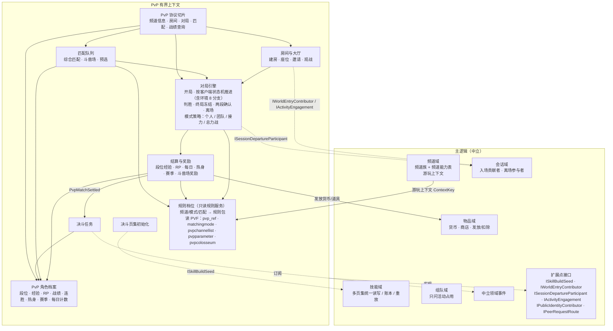

# PvP 架构重设计

2026-11-16。前置阅读：[PK 系统总览](PK系统总览.md)。本文只给架构与迁移方向，不含实现细节；落地前需用户拍板第 8 节。

目标：**PvP 是一个独立的有界上下文**。主逻辑（角色、技能、物品、属性、频道、会话、组队）只定义中立的扩展点，不出现 `if (pvp)`、`IsPvp`、`Pvp*` 类型或字段；PvP 的所有规则与状态在 PvP 模块内，经扩展点接入。

---

## 1. 现状：PvP 已经长进主逻辑

盘点（基线 `feature/pvp-duel-phase1@8ae9fbf61`）发现 PvP 渗入主逻辑只有两个根，但下游枝干很多：

**根 1：频道分类直接带 PvP 语义**
- `Data/Channel/ChannelModels.cs`：`ChannelEntryKind.FreeDuel/Pvp`、`IsPvp`、`IsTransient`（含 PvP）。
- `Data/World/WorldEntryModels.cs`：入场策略 `ChannelEntryPolicyState.PvpSkillProfileApplies`，由 `EntryPlacementRuleService` 与 `CharacterCurrentStateQueryDomainService` **各构造一次**（重复事实）。
- `Abstractions/Channel/IChannelSources.cs`：`FreeDuelChannelId`、`PvpTownId` 写在中立的频道配置里。

**根 2：主流程硬连 PvP 服务**

| 主逻辑位置 | PvP 枝干 |
|---|---|
| `Characters/SelectCharacterPreparationService` | `if (PvpSkillProfileApplies)` 播种并换决斗技能页；自带一套决斗页槽位分配 |
| `Characters/CharacterCurrentStateQueryDomainService` | `if (channel.IsPvp)` 换技能页 |
| `Characters/CharacterSkillLearningDomainService` | 决斗频道一律拒绝学技能、换槽、切页 |
| `Characters/CharacterEntryAssembly`、`CharacterRosterService` | 缺 PvP 行则角色进不了游戏；建角同步建 PvP 行；段位字节进公开身份 |
| `Sessions/SelectCharacterLifecycleServices` | 会话清理内嵌约 80 行 PvP 离场与结算编排；入场服务接口有 3 个 PvP 方法 |
| `Sessions/SessionAdjacentEntryDomainService`、`Data/World/SessionEntryModels` | 入场相邻状态带 `PvpLobby` 字段 |
| `Protocol/Game/SelectCharacter` | 每个频道插入战绩包、大厅快照、就绪标记、PvP 任务包 |
| `Protocol/Game/Party/PartyProtocolCommands` | REQUEST_PEER type 2 分给 PvP；"在房间内不能组队" |
| `Protocol/Game/StateSynchronization`、`TownProjection` | 大厅与房间编码；回城投影专为 PvP 加了 `ownState` 参数 |
| `Abstractions/World/ITownAreaDomainService` | 中立枚举里有 `TownAreaDepartureReason.PvpRoom` |
| 持久化 | `character_skills.mode IN ('pve','pvp')`；通用技能表接口上有 `ReadDuelSkillsAsync`/`InsertDuelSkillAsync` |

### SP 显示 65535 的成因（个例，说明问题本质）

- 直接原因：`Characters/SelectCharacterPersistenceServices.cs:81-85` 的 `PvpSkillProfileService.ReadAsync` 把决斗页 SP/TP 镜像写死成 `ushort.MaxValue`，bonus 写成 0；`CharacterStateProjection.MergePvpProfile` 把它整体覆盖到技能状态，`StateSynchronizationPayloadCodec.Entry.cs:310` 写进 SKILLINFO（NOTI `0x0013`）页头。客户端读取函数（VA `0x011783A0` → setter `0x019D65E0`）不判断 0xFFFF，照数显示。ClientStatic，High。
- 来历：照搬上游早期"决斗频道无限技能点"写法（本仓 `248abac23`，早于决斗一期）；上游已在 `2da23cf` 删除，理由是"65535 没有无限点的消费条件，只会显示为数值"（`ServerS4A21/Docs/决斗场业务实现.md` §10）。本仓 `Document/CurrentCharacterFacts.md:32` 与测试 `CharacterEntryInventoryTests.cs:269` 把错误写成了规则。
- **正确口径**：决斗页的 SP/TP 与普通页**同一本账**——按等级累计的 SP 表 + bonus，减去该页已学技能超出免费基线的花费。余额纯计算不入库；持久化的只有决斗页的已学行。本仓已有与页种无关的纯函数 `SkillPointLedgerRules.Calculate`，决斗页直接走它即可。上游与第三方现行做法一致，并允许在决斗频道加点、换槽。
- 另一套可能：70 的公平决斗以**决斗段位**为键授技能（`pvpskilltree` 的 `[level]` 是段位，`pvpskillpoint.etc` 给点数，`CUser::givePvPSkillTree` 0x08665400），A21 两份表对普通职业几乎全是 0，且公平决斗在 A21 未见入口。70Ref，High。
- 本质：这不是一处数值 bug，而是"决斗技能"被做成了一条平行的技能链（独立播种、独立读、独立镜像、禁止编辑），而不是"同一个技能系统里的另一个技能页"。

---

## 2. 设计原则

1. **主逻辑只认中立概念**。PvP 需要主逻辑配合的，都翻译成一个与 PvP 无关的能力或扩展点（"技能页""位置是否持久""活动占用""会话离场参与者"），主逻辑不知道是谁在用。
2. **派生优先**。凡能由角色基础数据 + 规则档位算出来的（技能点余额、公平属性、频道修正），一律计算，不复制、不平行存储。
3. **PvP 自己的事实只由 PvP 模块保存**：段位、RP、战绩、胜负、赛季、决斗任务、房间、对局。
4. **规则档位一次解析，按值传递**。会话进入频道时解析出不可变的上下文；下游只读它，不再各自 `ResolveAsync` 再判断。
5. **用机器守边界**：编译期项目引用图优先，其次是可达性与源码扫描测试，每条规则带反例。
6. 遵循现有样板：能力表（`DungeonRunCapabilities`）、以身份为键的权益表（`AuctionEntitlement`）、按键选策略（`IEquipmentEmancipatePolicy`）、`IEnumerable<>` 扩展点（`IDungeonBossClearHook`、各 `*DepartureSink`）、领域事件（Reliable / LiveOnly）。

---

## 3. 主逻辑与 PvP 的接缝

### 3.1 游玩上下文（主逻辑侧，中立）

会话进入频道时由频道域解析一次，挂在选中会话上，替代 `IsPvp`、`IsTransient`、`PvpSkillProfileApplies`、`SpecialTownOf`：

| 字段（中立） | 含义 | 取代 |
|---|---|---|
| `ContextKey` | 不透明的上下文键（频道族 + 规则档位标识） | 下游对 `ChannelEntryKind` 的判断 |
| `PersistsPosition` | 离线 / 传送时是否写回位置 | `IsTransient` |
| `HomeTown` | 指定城镇（空 = 普通） | `SpecialTownOf`、`PvpTownId` |
| `SkillBuild` | 使用哪个技能页集合（`Primary` / 某个命名页集） | `PvpSkillProfileApplies`、`MergePvpProfile` |
| `SkillEditing` | 该页集是否允许学技能、换槽、切页 | 技能学习里的三处拒绝 |

规则来源：频道域按频道脚本得到"频道族"，再查**频道能力表**（照 `DungeonRunCapabilities.Of(kind)`）。频道族由频道域拥有（它本来就读频道脚本），但能力表的字段全部中立。PvP 模块需要的 PvP 规则（记不记战绩、经验倍率、段位准入）**不放进这张表**，由 PvP 规则档位按 `ContextKey` 自己查。

### 3.2 扩展点清单（主逻辑定义接口，PvP 模块注册实现）

| 扩展点（主逻辑侧，名称中立） | 机制 | 样板 | PvP 侧的实现 |
|---|---|---|---|
| 技能页集合 | 技能域按 `SkillBuild` 读写同一张技能表的不同页集；账本、重放、学技能对任何页集一视同仁 | `SkillPointLedgerRules` 已与页种无关 | 无代码：决斗频道只是 `SkillBuild = Duel` |
| 技能页集初始化策略 `ISkillBuildSeed` | `IEnumerable<>` 按页集键选策略（照 `IEquipmentEmancipatePolicy`） | — | 决斗页集的首次播种与"升级后补授免费技能"规则 |
| 会话离场参与者 `ISessionDepartureParticipant` | 统一取代清理服务里逐个注入的地下城、两塔、PvP；每个参与者声明受影响会话、在清理事务内执行、提交后投影 | 现有 4 组 `*DepartureSink` | 房间离场、断线判负、结算触发 |
| 入场贡献者 `IWorldEntryContributor` | 入场时按上下文收集附加状态与帧（替代 `SessionAdjacentEntryState.PvpLobby`、`PlanPvpAsync`、`WithPvpRecord`、任务包） | `IReplayStateProjectionSink` | 大厅快照、名册发布、战绩包 `0x0030`、决斗任务列表 |
| 活动占用查询 `IActivityEngagement` | "这个角色现在是否被某项活动占用、能否组队/交易/传送"，各活动注册贡献 | — | 在房间或对局中即占用；组队侧只问占用，不认识房间 |
| 对等请求路由 `IPeerRequestRoute` | REQUEST_PEER / RESPONSE_PEER 按 type 注册处理者（Protocol 层，仍是一个消息一个 CMD） | 消息家族注册 | type 2 决斗邀请；将来 type 4 城镇 PK |
| 公开身份字段 `IPublicIdentityContributor` | USERINFO 等编码时由 Protocol 向贡献者取附加字段 | — | 段位、评级两个字节 |
| 角色属性/装备投影 `ICharacterViewContributor` | 按上下文对下发给客户端的属性与装备视图做投影 | — | 仅当证实服务端必须下发投影值时启用（公平决斗、强化归零）；客户端自行处理的不做 |
| 货币与商店 | 物品域的货币种类表与按货币计价的商店，中立 | `AuctionEntitlement`、现有钱包 | 胜点 / 奖章是一种货币；PvP 只调用发放接口 |
| 领域事件 | 主逻辑发布中立事件（入世界、离世界、升级、转职） | `DungeonParticipantLeft` | PvP 订阅：决斗页补授、任务进度 |

主逻辑侧从此只有：频道能力表、上述接口、中立事件。**删除**：`IsPvp`、`PvpSkillProfileApplies`、`TownAreaDepartureReason.PvpRoom`（改为中立的"进入活动场地"）、`SessionAdjacentEntryState.PvpLobby`、入场服务的 3 个 PvP 方法、技能表上的 Duel 专用方法、`TownReturnProjection` 的 PvP 专用参数（改为活动场地离场的中立选项）。

### 3.3 每项 PvP 需求走哪个接缝

| 需求 | 接缝 | 持久化 / 计算 |
|---|---|---|
| 决斗技能页与 SP | 游玩上下文 `SkillBuild` + 技能域统一处理 + `ISkillBuildSeed` | 持久化决斗页已学行（及玩家加点）；SP/TP 余额纯计算 |
| 70 式按段位授技能（若采用） | `ISkillBuildSeed` 的另一实现，读段位查询 | 授予结果写决斗页；段位由 PvP 档案提供 |
| 公平决斗属性/装备统一 | 客户端读 PVF 自行处理（`fairpvpstat`、`fairpvpequipment`）；服务端只在需要时用 `ICharacterViewContributor` | 纯计算 |
| 新手频道强化/增幅归零、经验 70% | 归零：PVF 说明显示由客户端按频道处理（待实机）；经验倍率：PvP 规则档位 | 纯计算 |
| 频道准入（段位、等级） | 频道入场前置检查扩展点（频道域调用中立的准入贡献者） | PvP 规则档位 + 档案查询 |
| 段位、经验、RP | PvP 角色档案 | 持久化 |
| 胜点 / 奖章与商城 | 物品域货币 + 中立商店；PvP 结算发放 | 持久化在货币（物品域） |
| 决斗任务 | PvP 任务模块订阅对局/结算事件 | 持久化在 PvP |
| 每日次数、赛季 | PvP 档案与结算 | 持久化在 PvP |
| 大厅、房间、对局 | 入场贡献者 + 会话离场参与者 + 活动占用 + 对等请求路由 | 运行态在 PvP |
| 匹配、斗兽场、总力战 | 全部在 PvP 模块内；斗兽场门票走物品域扣除接口 | 队列运行态；编队与门票记录在 PvP |
| 位置不持久、指定城镇 | 频道能力表 | 计算 |

---

## 4. PvP 模块内部划分

依赖方向：PvP → 主逻辑的中立接口；主逻辑**从不**引用 PvP。PvP 内部：协议切片 → 房间/匹配/引擎/档案；房间、匹配 → 引擎；引擎、结算、匹配 → 规则档位；结算 → 档案、物品域。

各模块的状态 owner：

| 模块 | 拥有的状态 |
|---|---|
| 规则档位 | 无（只读 PVF 与频道脚本） |
| PvP 角色档案 | 段位、经验、RP、战绩、连胜、热身、赛季、每日计数（持久化） |
| 对局引擎 | 进行中的对局（内存，事务参与者，延续一期写法） |
| 房间与大厅 | 房间、座位、邀请、大厅就绪者（内存） |
| 匹配队列 | 队列（内存） |
| 决斗任务 | 任务进度（持久化） |
| 决斗页集初始化 | 无（写入技能域的决斗页集） |

---

## 5. 用机器守住边界

推荐分两步：

**第一步（重构完成即生效）：测试守护**
- **可达性**：照 `DependencyGraphArchitectureTests` 的 `ReachViolations`，断言角色、技能、会话、频道、组队、物品的领域服务在生产 DI 图上不可达任何 PvP 类型。
- **中立表面**：照 `PartyBoundaryArchitectureTests`，扫描 `Data.Channel`、`Data.World`、`Abstractions.Sessions/Characters/World/Channel/Persistence` 的公开类型，成员类型与成员名不得含 `Pvp`、`Duel`。
- **源码白名单**：照 `EventNotificationBoundaryTests`，`Pvp`/`Duel`/`IsPvp` 等标识只能出现在 PvP 命名空间、组合根注册行与少数登记文件。
- 每条规则配反例自检，防止规则放行一切。

**第二步（扩展点稳定后）：独立项目**
- `Dfo.Server.Pvp`（领域与规则，引用 Abstractions、Data 与 Application 的公开机制）与 `Dfo.Server.Pvp.Protocol`（协议切片，引用 Protocol、Networking）。主逻辑项目不引用它们，编译期强制单向；组合根按 `IServerModule` 追加。
- 照 `HttpApiArchitectureTests` 断言两个项目的 `ProjectReference` 精确集合。
- 前提：PvP 用到的执行器、命令、事件、调度机制须为 public（已确认 `TypedGameplayTimerSource`、`ICommandBus`、内部命令注册、事件注册为 public）；PvP 表的持久化实现放在 PvP 项目内或经 Persistence 的契约提供（建表仍归 `Persistence/Schema` 唯一 owner，需裁定）。

---

## 6. 一期代码的处置

| 一期内容 | 处置 |
|---|---|
| 规则服务与内容源（`pvp_ref`、地图） | 保留，迁入规则档位；扩展读 `matchingmode`、`pvpchannellist` 等 |
| 战绩 Store、v11 表 | 保留，迁入 PvP 档案；按积分裁定补 RP、热身、赛季列（新版本迁移） |
| 房间领域服务（事务参与者、邀请、座位） | 保留核心，拆为"房间与大厅"与"对局引擎"；阶段推进改为按客户端状态机（含环境 8 分支） |
| 结算领域服务、`PvpMatchSettled` | 保留，迁入结算模块；改为按规则包计算 |
| 截止调度、停服服务 | 保留 |
| 协议切片（房间、对局、频道信息） | 保留编解码；投影改走入场贡献者与离场参与者 |
| 大厅服务（在 Sessions）、决斗技能仓储（在 Characters） | 迁出主逻辑 |
| 主逻辑里的分支与 PvP 字段（第 1 节表） | 全部删除，改为扩展点 |
| 决斗技能页 65535、禁止编辑、只首次播种 | 推倒：改为同一技能系统的另一页集 |
| `CurrentCharacterFacts.md` 中的"无限点数"、对应测试 | 更正（跨界修正记载） |

### 迁移顺序

每步一个独立提交，纯搬迁与语义改动分开，一次到位不留兼容层：

1. **R1 中立化主逻辑（行为不变）**：频道能力表 + 游玩上下文取代 `IsPvp`/`IsTransient`/`PvpSkillProfileApplies`（消除重复构造）；会话离场参与者统一四个玩法；入场贡献者、活动占用、对等请求路由、公开身份贡献者落地，现有 PvP 逻辑改为实现这些接口。以字节基线与现有测试证明行为不变。
2. **R2 纯搬迁**：大厅服务、决斗技能仓储、PvP 相关表接口与协议投影搬入 PvP 命名空间；加上第 5 节第一步的边界测试。
3. **R3 技能页集统一（语义变更）**：技能域多页集统一读写与账本；决斗页集 SP 按账本计算、允许编辑（按裁定）；修正 65535。
4. **R4 PvP 内部重组**：规则档位、档案、对局引擎（按客户端状态机）、结算按规则包。
5. **R5 新玩法**：按裁定的首批范围（匹配 1v1 或频道规则等）。
6. **R6（可选）独立项目**。

R1–R3 对普通玩法也有收益（重复构造、会话清理的四套写法），可以先于 PvP 新功能合入主干。

---

## 7. 与一期 PR 的关系

一期分支尚未推送。建议：**不以当前形态合入主干**。在同一分支（或新分支）上先做 R1–R3，再把一期的 PvP 实现按 R2/R4 迁入新结构后一起提交，避免主干先长出枝干再拆。

---

## 8. 需要用户拍板

| # | 事项 | 建议 | 理由 |
|---|---|---|---|
| 1 | 频道口径 | 以 PVF `(r)pvpchannellist` 的分档（新手/初级/中级/高级/至尊/自由练习/竞技大赛）为准建频道族，每族对应客户端认识的登录环境（实机确认后定 8/13/24 的分配） | 规则（记不记胜负、经验倍率、段位准入）都写在 PVF 的分档里；环境值决定客户端加载分支，必须与之对齐 |
| 2 | 段位刻度 | 以 `pvp_ref` 的 0–20 为准；0–29 的频道与任务分档按比例映射或实机核对客户端显示后再定 | 结算与经验表只有 0–20 一套完整数据 |
| 3 | 积分 | 段位经验与 RP 都做：段位经验决定段位（`pvp_ref`），RP 用于匹配与排名（`matchingmode` ELO） | 两套在 PVF 中并存且用途不同 |
| 4 | 首批范围 | R1–R3 + 规则档位 + 档案 + 自由房间迁入新结构；匹配 1v1 放下一批 | 先把结构立住；匹配需先实机确认入口 |
| 5 | 决斗技能页口径 | 与普通页同一账本，允许在决斗频道加点与换槽（上游现行做法）；首次进入按免费授予播种，升级/转职后补授 | 符合"派生而非复制"；70 的按段位授技能仅属公平决斗，A21 未见入口 |
| 6 | 隔离强度 | 先测试守护（第 5 节第一步），扩展点稳定后拆独立项目 | 一步到位拆项目需要先有扩展点，否则形成项目环 |
| 7 | 一期 PR | 不单独合入，随 R1–R4 一起 | 见第 7 节 |

---

## 9. 证据与参考

- 主逻辑分支盘点、扩展点样板与架构测试先例：本次调研（文件:行号见第 1、3、5 节引用）。
- SP 65535：`SelectCharacterPersistenceServices.cs:81-85`、`SelectCharacterPreparationService.cs:277-278`、`CharacterStateProjection.cs:41-47`、`StateSynchronizationPayloadCodec.Entry.cs:310`；客户端 VA `0x011783A0`、`0x019D65E0`；上游 `SkillPointState.cs:46-66`、`2da23cf`；70 `importPairPvPSkillPointScript` 0x08a5e226、`getPvPSkillPoint` 0x08a5dd62、`SetPvPSkillTree` 0x084bff8e、`CUser::givePvPSkillTree` 0x08665400。
- PK 系统全景与 PVF 数据：[PK 系统总览](PK系统总览.md)。
