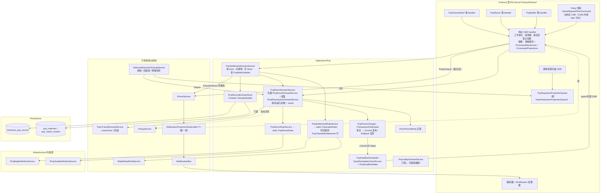
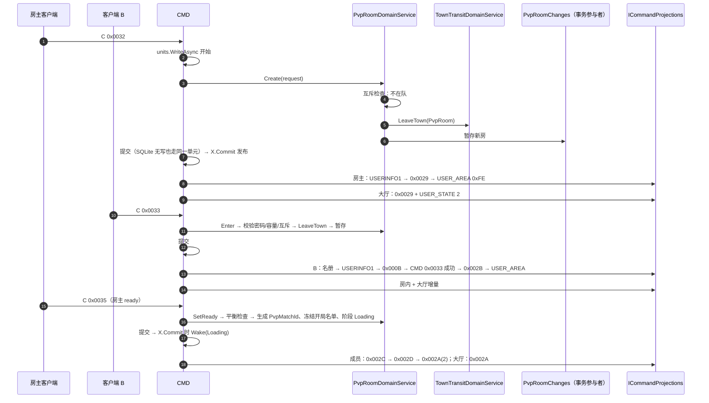
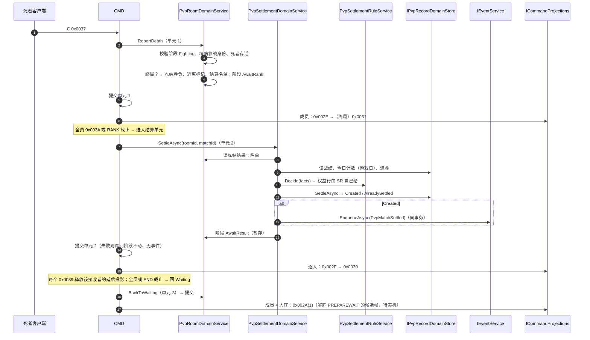
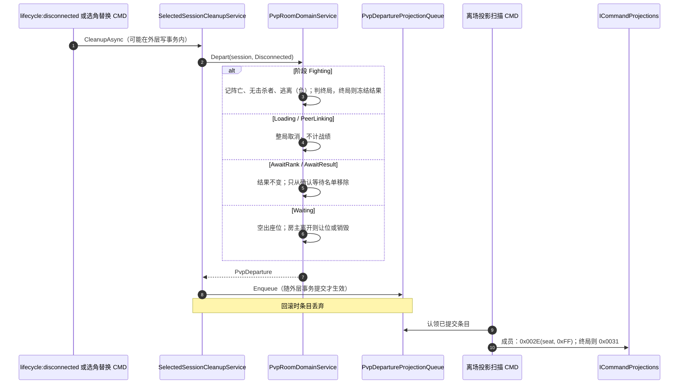
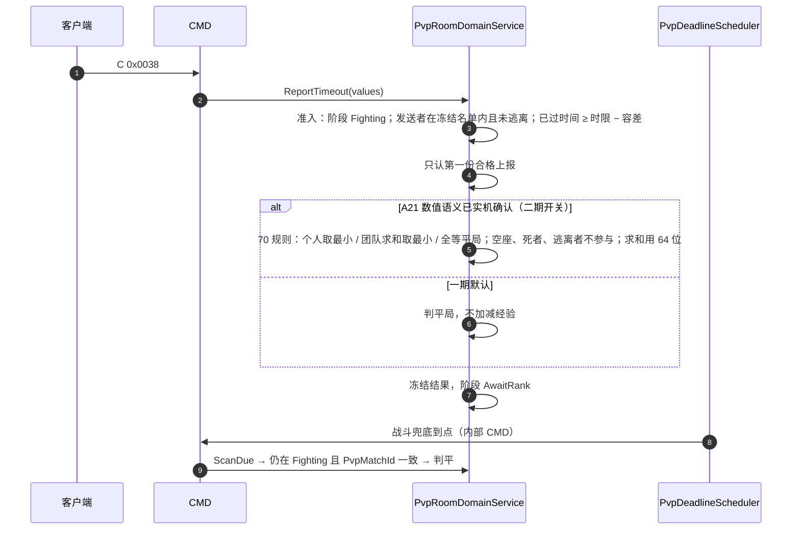

# 决斗场（PvP）方案与领域架构 · 修订版 r1（经 Codex gpt-6-astra high 审核）

本版合并并取代上面两条评论（[实现方案](https://github.com/Gloria-GK-406/DNF-JP-86-Server/issues/81#issuecomment-6871600378)、[领域架构设计](https://github.com/Gloria-GK-406/DNF-JP-86-Server/issues/81#issuecomment-6873319957)）。参照调研（70 / 上游 / 第三方 / 客户端）没有变化，仍见第一条评论第 1 节，本版不再重复。只出方案，未改代码。基线 `main@ef20398a3`。

审核方式：`codex exec -m gpt-6-astra -c model_reasoning_effort=high -s read-only`，在服务端仓库内读 AGENTS.md、Document/ 下架构文档和设计点名的源码后审核；禁止反汇编和读二进制。Astra 结论为 **changes_required**（方向认可，阻断在规则调用边界、内存与数据库事务一致性、清理投影时机）。它引用的每条代码证据我都打开核对过，全部属实。

---

## 0. Astra 审核意见与采纳情况

| # | 意见摘要 | 严重度 | 采纳 | 核实与改动位置 |
|---|---|---|---|---|
| 1 | 结算图里 CMD 直接调规则服务、读权益表、`EnqueueAsync` 发事实，与"CMD 不问规则服务"矛盾 | Blocker | **采纳** | 核实：`Document/Architecture.md:102–105`；`CommandHandlerArchitectureTests.cs:54` 只放行 `ICommandProjections`（"只登记即时投影，不发布领域事实"）。改为领域结算服务 `IPvpSettlementDomainService` 收 facts、问规则、写 Store、发事件；CMD 只管工作单元与提交后投影。→ §2、§3、§4 b |
| 2 | 房间内存态与数据库结算没有原子提交，回滚后房间仍会前进 | Blocker | **采纳** | 核实：`IllusionTowerDomainService.cs:334` 用 `Changes : ITransactionParticipant` 暂存、提交才发布；`GameplayExecution.md:105`。房间改为事务参与者 `PvpRoomChanges`，暂存 → Commit 发布 → Rollback 丢弃；唤醒放在提交里。→ §3.2、§4 |
| 3 | 离场 sink 直接 `ProjectAsync`，选角替换时处在未提交写事务内会被拒 | Blocker | **采纳** | 核实：`GameSelectCharacterCommand.cs:574/596` 在写工作单元内调清理；`EventService.cs:72` 拒绝未提交写事务内投影。实际类名 `SelectedSessionCleanupService`（前版写错）。改为照 `TowerDepartureProjectionQueue` 的离场投影队列：清理只入队，提交后由扫描 CMD 认领投影；会波及他人结算时扩展 `AffectedSessions`。→ §3.3、§4 c |
| 4 | 同一 REQUEST_PEER 不能按 type 绑定多个 CMD；RESPONSE_PEER type 2 接受流程缺失 | Major | **采纳** | 核实：`CommandHandlerRegistry.cs:99–102`"一个逻辑消息只能属于一个协议 CMD"；`PartyProtocolCommands.cs:243` 对非 0 type 忽略。改为保留 `GameRequestPeerCommand` / 响应 CMD 各一个，在 CMD 内按 type 分派到组队或 PvP 领域能力；补邀请创建、接受、过期契约。→ §3.1、§5 |
| 5 | 终局后断线不应改变已定胜负 | Major | **采纳** | 终局时冻结胜负、逃离标记、结算名单；战斗中离场判负，终局后离场只影响确认等待。待拍板 #6 措辞随之修改。→ §4 b/c、§8 |
| 6 | 确认超时 ≠ 客户端已退出结果界面；延后离场座位要按接收者释放 | Major | **采纳** | 核实：`protocol/game/client-to-server/0x0039.md` 空体，不带比赛编号。按"接收者精确会话 + 比赛"保存待释放投影；补迟到 ACK、下一局开始、UID 复用、房间销毁的处置。→ §3.3、§4 b |
| 7 | "第一份超时上报定胜负"缺准入：时窗、发送者资格、数值筛选 | Major | **部分采纳** | 采纳准入检查（阶段、精确参战身份、最早接受时间、空座/死者/逃离者/并列/溢出处理）和"服务端兜底结束与客户端数值裁决分开建模"。**不采纳**"放弃 70 语义"：70 `PvP_Room::time_out` 已确认"个人取最小、团队求和取最小、全等平局"，保留为目标规则；但 A21 数值含义抓包确认前，超时一律判平、不授经验（待拍板 #8 修改）。→ §4 d、§8 |
| 8 | 加载、P2P 就绪、倒计时、战斗、心跳之间缺阶段转移 | Major | **采纳** | 补阶段转换表；心跳只在客户端确实发送的阶段计时；开战前失败取消、不计战绩（待拍板 #7 修改）。→ §4.1 |
| 9 | 幂等只写了两个 generation，没覆盖重启和重复事件 | Major | **采纳** | 核实：`EventService.cs:30` 每次 Enqueue 新 EventId。房间与比赛身份改用跨重启唯一的 `Guid`；Store 返回 `Created / AlreadySettled`，只有首次发布 `PvpMatchSettled`；读计数、判定、写结果同一工作单元。→ §3.2、§6 |
| 10 | 正常停服会走断线判负，与"重启不结算"冲突 | Major | **采纳** | 核实：`GameplayExecution.md:167` 停机时传输排空会拆连接并清理。连接拆除前由 PvP 停服内部 CMD 把未终局比赛标为"停服取消"；崩溃、停服、已终局未提交分别定义。待拍板 #15 措辞修改。→ §4 e |
| 11 | 战绩表迁移漏掉 `skills_initialized` 及其读写链 | Major | **采纳** | 核实：`CharacterBodyTables.cs:100` 仍读该列，`SelectCharacterPersistenceServices.cs:37` 据此初始化决斗技能。改为 `character_pvp` 拆分：技能初始化标记留给技能状态 owner；列出每个旧字段去向与消费方。→ §6 |
| 12 | 进退房没闭合服务端位置与组队互斥 | Major | **采纳** | 核实：`TownTransitDomainService.LeaveTown`（`:121`）是离城入口。进房走现有离城入口、退房走回城入口，不在房间里存位置；房间与队伍双向互斥（进房后也不能接受组队邀请）。待拍板 #11 扩大为双向。→ §3.4 |
| 13 | 经验规则缺边界；"满级不再加减"依据不足；游戏日要复用现有规则 | Minor | **采纳** | 补边界表；游戏日用 `IDailyResetRuleService`；"满级不再增长"与"满级免扣"拆成两条待拍板（#5 拆为 #5a/#5b）。→ §7、§8 |
| 14 | 协议风险没覆盖所有布局分歧；字节测试会固化假设 | Minor | **采纳** | 每条一期协议列"候选布局/冲突/采用依据/验证前限制"；golden 测试分"上游表征"与"A21 样本基线"。→ §5、§9 |
| 15 | 机器检查承诺超出现有判据覆盖；漏了状态普查登记 | Minor | **采纳** | 核实：`GameplayExecution.md:28–31` 新增进程内可变状态必须进 `GameplayWriteEntryTableTests` / `GameplayStateCensusTests`。检查表按"编译期/启动期/结构测试/行为测试"分开写，补状态登记与反例。→ §10.2 |
| 16 | 大厅回等待同时被列为一期流程和二期修正 | Minor | **采纳** | 房间创建、成员变化、开战、回等待、销毁的大厅增量全部纳入一期；实机加第三个大厅观察客户端（protocol3）。→ §5、§9 |

采纳 15 条，部分采纳 1 条（#7），不采纳 0 条。

---

## 1. 结论速览（修订后）

- 战斗本身是客户端 P2P，服务端负责频道、大厅、房间、开局、收死亡/超时上报并由服务端判胜负、两段确认结算、存战绩。
- **新增的三条硬约束**（来自审核）：
  1. 房间内存态是**事务参与者**，与战绩写库同进同退；
  2. 结算由**领域结算服务**完成，CMD 不碰规则服务和领域事实；
  3. 离场（断线、回选角、停服）只产生离场结果并**入队**，提交后再投影。
- 分期不变：一期自由房个人/团队 + 结算（只频道 24 记战绩）；二期接力、死斗、观战等；三期匹配/排位/赛季/斗兽场/总力战。
- 一期验收增加第三个大厅观察客户端。

---

## 2. 架构总图（修订）

与前版的差别：CMD 不再连规则服务、权益表和 `EnqueueAsync`；新增 `PvpSettlementDomainService`、`PvpRoomChanges`、离场投影队列与扫描 CMD；位置走 `TownTransitDomainService`；邀请不再新增 CMD。

---

## 3. 组件职责

### 3.1 组件表

| 组件 | 层 | 做什么 | 拥有的状态 | 不能做什么 | 依赖 |
|---|---|---|---|---|---|
| PvP 三个切片的 CMD | Protocol | 开工作单元、调领域服务、**提交后**按阶段登记投影 | 无 | 不注入规则服务、Store、`IEventService`；不发布领域事实 | 领域服务、`ICommandWorkUnits`、`ICommandProjections` |
| `GameRequestPeerCommand` 与 REQUEST_PEER 响应 CMD（已有） | Protocol | 在 CMD 内按 type 分派：0 → 组队，2 → `IPvpRoomDomainService.Invite / AcceptInvite` | 无 | 不再派发另一个 CMD | 现有依赖 + `IPvpRoomDomainService` |
| `PvpRoomDomainService` | Application | 房间全部写操作 + 邀请（含 token、过期）；进/退房经 `TownTransitDomainService` 改位置；与队伍互斥 | 房间运行态（经 `PvpRoomChanges` 提交） | 不读内容源、不写库、不查连接、不另存当前位置 | `IPvpRoomRuleService`、终局规则、`ITownTransitDomainService`、`IPartyService`（只读是否在队）、`IPvpDeadlineWake` |
| `PvpRoomChanges` | Application | 当前事务内的房间暂存；Commit 发布、Rollback 丢弃；Commit 时唤醒调度器 | 本事务的变更 | `CommitCanFail = false`（SQLite 是唯一可失败者） | — |
| `PvpSettlementDomainService` | Application | 读冻结的结算名单 → 读战绩与今日计数 → 问规则 → 写 Store → 首次结算才 `EnqueueAsync(PvpMatchSettled)` → 推进房间阶段 | 无 | 不知道协议 | `IPvpRoomDomainService`、`IPvpSettlementRuleService`、`IPvpRecordDomainStore`、`IEventService` |
| `PvpRoomRuleService` + `PvpRoomRules` | Application | 座位转移、分队、平衡、地图 | 无 | 不查世界 | `IPvpMapDefinitionSource` |
| `PvpSettlementRuleService` + `PvpGradeRules` | Application | 经验/段位/上限；**唯一提供 `PvpChannelEntitlements` 行**；游戏日问 `IDailyResetRuleService` | 无 | 不读库 | `IPvpGradeDefinitionSource`、`IDailyResetRuleService` |
| `IPvpTerminalRule` 实现 | Application | 纯函数判终局 | 无 | — | — |
| `PvpBattleModeCapabilities` / `PvpChannelEntitlements` | Abstractions | 能力表 / 以频道环境为键的权益记录 | 静态 / 由规则服务构建 | 调用方不写 `if (env == 24)` | — |
| `IPvpRecordDomainStore` | Abstractions / Persistence | 战绩真源；`SettleAsync` 返回 `Created(结果)` 或 `AlreadySettled(已存结果)` | 三张表 | 不算规则 | SQLite 参与者 |
| `PvpDeadlineScheduler` + 各 `PvpDeadlineSource` | Application | 邀请、加载、P2P 就绪、心跳、RANK/END 确认、战斗兜底、离场投影扫描 | 不存截止时间 | 不在执行器外读写 | `ICommandBus`（基类） |
| `PvpDepartureProjectionQueue` | Protocol | 清理产生的离场结果入队；扫描 CMD 提交后认领投影；按接收者 + 比赛保存延后释放的座位投影 | 待投影条目 | 不改房间 | — |
| `SelectedSessionCleanupService`（已有） | Application | 清理链里加一步 `Depart(session, reason)`，结果入队；`AffectedSessions` 加入同房会被波及的成员 | — | 不直接投影 | 新增 `IPvpRoomDomainService`、队列 |

### 3.2 事务与身份

- 房间、比赛身份用 `Guid`：`PvpRoomId`（建房生成）、`PvpMatchId`（开局生成）。线上用的 `u16 roomId` 只是 Protocol 的显示编号映射，不当身份。
- 结算工作单元内顺序：读名单与计数 → 规则决策 → `SettleAsync` → 首次才发事件 → 房间阶段变更进 `PvpRoomChanges`。SQLite 提交失败 → 房间阶段不前进、事件不出、调度器不唤醒。
- 投影一律在工作单元结束后登记。

### 3.3 离场投影队列

- 入队条目：`(PvpRoomId, PvpMatchId?, 离场者, 离场原因, 每个接收者精确会话)`。
- 战斗中的离场：扫描 CMD 投影 `0x002E(seat, 0xFF)`，终局再投 `0x0031`。
- 结果界面期间的座位移除：按接收者保存，收到该接收者的 `0x0039`，或该接收者进入下一局/离开房间/会话替换时释放；房间销毁时全部丢弃。确认超时只推进服务端阶段，**不**释放这些条目。
- 迟到 `0x0039`（空体，无比赛编号）：只按"当前会话所在房间处于 AwaitResult"认领，否则忽略；下一局开局前清除旧比赛的待确认状态。

### 3.4 位置与组队

- 进房：`TownTransitDomainService.LeaveTown(..., reason: PvpRoom)` 移出城镇区域、保留落点（需在 `TownAreaDepartureReason` 加成员）。失败则进房整体回滚。
- 退房/房间销毁：走现有回城入口，回到原落点；Protocol 再映射 USER_AREA、USER_STATE 0、AREA_USERS。
- 互斥：在队不能建房/进房；在房不能接受组队邀请（组队入口检查 `IPvpRoomQueryDomainService.IsSeated`）。快速重连按会话替换走清理链。

---

## 4. 协作时序（修订）

### 4.1 阶段转换表

| 阶段 | 进入条件 | 客户端发什么 | 截止时间 | 超时后果 |
|---|---|---|---|---|
| Waiting | 建房 / 结算完成 | — | — | — |
| Loading | 房主 ready 且条件满足，发 0x002D | 0x012A | 加载截止（待实机定，建议 60s） | 未加载者移出，**整局取消、不计战绩** |
| PeerLinking | 全员 0x012A | 0x012B | P2P 截止（建议 30s） | 同上，取消 |
| Countdown | 全员 0x012B 报连通 | — | 5s（客户端倒计时） | 进入 Fighting |
| Fighting | 倒计时结束 | 0x0037、0x0038、0x006E | 战斗兜底 = PVF 时限 + 宽限；心跳截止仅在此阶段计 | 兜底 → 判平；心跳超时 → 按离场判负 |
| AwaitRank | 终局（结果已冻结） | 0x003A | 10s | 推进结算 |
| AwaitResult | 已写库 | 0x0039 | 10s | 推进回 Waiting（不释放延后投影） |

心跳是否在 Fighting 全程每 10s 发送要实机核对（`unit-007.md:232` 有两个状态标志条件）。

### a) 建房 → 进房 → 准备 → 开局

### b) 死亡 → 判胜 → 两段确认 → 写库 → 回等待

### c) 战斗中断线 / 回选角

### d) 对战超时

### e) 停服 / 崩溃

- **正常停服**：宿主停止接受连接后、传输排空拆连接**之前**，由 PvP 停服内部 CMD 把所有未终局比赛标为"停服取消"、取消截止时间；之后的断线清理看到取消标记，不判负。
- **已终局未写库**：停服 CMD 先按冻结结果完成结算再取消其余。
- **进程崩溃**：房间不落库，进行中比赛消失，不结算；已提交的结算保留。

---

## 5. 一期协议清单（含候选布局与验证前限制）

| Type | 候选布局 | 冲突 / 依据 | 验证前限制 |
|---|---|---|---|
| C 0x00C3 | 空；回 `u8 1, i32 0, u8 0` | 后 5 字节含义未知（上游） | 只实现上游回包 |
| C 0x0032 | `u8 nameType [Dstr≤29] i16 map u8 hasPwd [Dstr≤8] u8 special` | 静态走图漏密码分支；成功是否回 CMD 未知 | 成功不回 CMD；抓包确认 |
| C 0x0033 | `u16 roomId u8 hasPwd [i32 len + ≤8B]` | 静态页只列 3B | 密码房一期保留，但入房含密码路径须抓包后才算完成 |
| C 0x0034 / 0x0035 / 0x003B | 2B / 1B / 2B | 一致 | — |
| C 0x0036 | `u8 mode` | 多构包点形状不一致 | 只接受 1B，其他长度拒收并记日志 |
| C 0x0037 | 上游 2B/5B；70 `u16 killer`；静态 ≥7B | 三方冲突 | 抓包定一种，只实现那一种 |
| C 0x0038 | 上游 8×i32 | 静态仅"重复 4B 组" | 长度不符拒收；语义见 §4 d |
| C 0x003A | 上游 70B | 静态下界 | 只当确认，长度不校验内容 |
| C 0x0039 / 0x012A / 0x006E | 空 | — | — |
| C 0x012B | `u8 n + n×2` | — | — |
| NOTI 0x0029 / 2A / 2B / 2C / 2D / 2E / 31 | 见第一条评论 §2 | 均为上游 + reader 消费链 | golden 标"上游表征"，实机后换"A21 样本基线" |
| NOTI 0x002F / 0x0030 | 26+19n / 51B（房间上下文 +3×26B） | 只有上游一个来源 | 同上 |
| 000A/000B/NOTI 0007 type 2 | 7B；拒绝不发包 | A21 只验证过 type 0 | 抓包 |
| 大厅增量 | 建房、成员变化、开战、回等待、销毁都发 0x0029/0x002A/0x002B | 上游结算后只发房内（缺陷） | 一期全部发给大厅 |

---

## 6. 数据模型与迁移（修订）

`character_pvp` 旧列逐一去向：

| 旧列 | 去向 | 消费方 |
|---|---|---|
| `pvp_grade`、`pvp_rating_grade` | `character_pvp_record.grade / rating_grade` | `CharacterEntryAssembly.cs:216`（USERINFO）、PVP_RECORD——改为经同一战绩查询读取 |
| `skills_initialized` | **留在技能状态 owner**：新建或并入 `character_pvp_skill_state`，不进战绩表 | `CharacterBodyTables.cs:100`、`SelectCharacterPersistenceServices.cs:37` |
| `pvp_rank_point`、`pvp_stat_a`、`pvp_win_streak`、`pvp_lose_streak` | 语义不明：非 0 值原样存入迁移审计表 `character_pvp_legacy`，不进入新战绩 | 无（迁移报告列出） |

新表：

- `character_pvp_record(character_id PK, win, lose, draw, grade_experience, grade, rating_grade, win_streak, peak_win_streak, updated_at)`。迁移时 `grade_experience` 初值 = 旧 `grade` 在 A21 `pvp_ref.etc` 阈值表中的下限，保证段位不因迁移变化。
- `pvp_matches(match_id TEXT PK /*Guid*/, room_id TEXT, listener_port, channel_env, battle_mode, outcome_kind /*Win/Draw/Cancelled*/, winner_seat, game_day, completed_at)`。
- `pvp_match_results(match_id, character_id, seat, team, outcome, kills, deaths, fled, previous_grade, grade, experience_change, …, PK(match_id, character_id))`。
- schema 版本 +1，`Tool/DbMigrate` 迁移；房间不落库。

---

## 7. 经验规则边界（修订，供拍板）

| 情形 | 建议 |
|---|---|
| 0 段（入门）首胜 | 直接升到 1 段下限（上游做法，`决斗场业务实现.md:124`） |
| 当日第 1–50 胜 | 按 `[pvp grade point]` 本段胜经验加 |
| 当日第 51 胜起 | 胜场照记，经验 0 |
| 当日第 1–10 负 | 按本段负经验扣 |
| 当日第 11 负起 | 负场照记，经验 0 |
| 跨段 | 加减后按累计经验重新查段位，可一次跨多段 |
| 平局 / 超时判平 / 取消 | 经验 0；平局记 draw，取消不记场次 |
| 逃离（战斗中离场） | 按负处理，计入当日负场数 |
| 游戏日 | 用 `IDailyResetRuleService` 的游戏日；比赛归属按**开局时**的游戏日 |
| 满级段 | 拆为 #5a 不再增长、#5b 是否免扣（见 §8） |

---

## 8. 需用户拍板的规则（修订后，共 17 条）

带 ★ 的是本轮相对上一版有改动的条目。

| # | 规则 | 建议值 | 理由 |
|---|---|---|---|
| 1 | 一期开放模式 | 1 个人、2 团队 | 不变 |
| 2 | 记战绩的频道 | 只频道环境 24 | 不变 |
| 3 | 经验 / 段位算法 | A21 PVF `[pvp grade point]` 每段固定胜负经验，边界见 §7 | 不变，补边界 |
| 4 ★ | 每日上限 | 胜 50 / 负 10，之后经验 0、场次照记；按开局时的游戏日 | 补边界、游戏日复用现有规则 |
| 5a ★ | 满级段是否继续增长 | 不增长 | PVF `[pvp experience max grade]` 封顶 |
| 5b ★ | 满级段输了扣不扣 | **扣**（与其他段一致） | 前版"满级不再加减"无依据（Astra #13）；免扣是定制规则，需你明确要才加 |
| 6 ★ | 中途离开 / 断线 | **战斗中**离开判负；终局后离开不改结果；开战前（加载/连通阶段）离开整局取消 | 终局后结果冻结（Astra #5、#8） |
| 7 ★ | 心跳超时 | 30s，只在 Fighting 阶段计；加载、连通另设截止（建议 60s / 30s），超时取消不计战绩 | 心跳不是全程发送（Astra #8） |
| 8 ★ | 对战超时 | 一期：客户端超时上报或服务端兜底（PVF 时限 + 30s）都**判平、不加减经验**；A21 超时数值含义抓包确认后，再按 70 规则（最小者胜）启用 | 70 语义确认，但 A21 数值未证实，不能让未验证路径授予永久战绩（Astra #7） |
| 9 ★ | 结算确认超时 | RANK、END 各 10s；超时只推进服务端阶段，不替客户端"退出结果界面" | Astra #6 |
| 10 | 奖励 | 一期只有胜负场、经验、段位、连胜 | 不变 |
| 11 ★ | 组队与房间 | **双向互斥**：在队不能建房/进房，在房不能接受组队邀请 | Astra #12 |
| 12 | 装备差异 | 允许 | 不变 |
| 13 ★ | 密码房 | 一期保留，但含密码的入房须抓包验证后才算完成 | 静态页只有 3B，布局未证实（Astra #14） |
| 14 | 观战 | 二期 | 不变 |
| 15 ★ | 重启 / 停服 | 正常停服：未终局比赛取消、不判负；已终局未写库的先结算；崩溃：未提交的全部丢弃 | 停服会经过断线清理（Astra #10） |
| 16 | 每日对战次数 | 不限 | 不变 |

---

## 9. 测试策略（修订）

- **规则单测**：§7 每一行一个用例（第 50/51 胜、第 10/11 负、首胜、跨段、平局、逃离、跨游戏日开局）；终局判定；超时准入（早到、非参战者、死者、并列、溢出）。
- **事务测试**：SQLite 提交失败时房间阶段不前进、无 `PvpMatchSettled`、调度器不唤醒；重复结算返回 `AlreadySettled` 且不重发事件。
- **离场与竞态**：选角替换（外层写事务内）离场 → 回滚时队列无条目；胜者在 RANK 前 / 写库后 / END 前断线，结果都不变；迟到 0x0039 不认领到下一局；正常停服不产生负场。
- **位置与互斥**：进房后城镇区域无该角色、退房回到原落点；在房接受组队邀请被拒。
- **迁移测试**：旧 `character_pvp` 各列去向、`skills_initialized` 不丢、迁移前后段位不变。
- **字节测试**：golden 分"上游表征"（一期）和"A21 样本基线"（实机后替换）；长度相符不等于状态机有效。
- **集成测试**：两个假客户端完整一局 + 第三个大厅观察者，断言大厅视图与重新入大厅取得的快照一致。
- **实机**：protocol + protocol2 对战，protocol3 留在大厅观察。可失败检查：结算后回 WAIT（卡 PREPAREWAIT 即失败）、经验条非 0/0、重登战绩一致、拔线判负、停服重启无负场、大厅看到房间回等待。

---

## 10. 可扩展性（修订）

### 10.1 扩展点

与上一版 §4.1 相同（接力、死斗、观战、快速加入、练习房、胜点、战绩详情、任务、匹配/排位/赛季、公平决斗、斗兽场、总力战的落点不变），只改一处：所有"订阅 `PvpMatchSettled`"的扩展依赖本版的"首次结算才发布"保证。

### 10.2 防腐化检查（按保证类型分开写）

| 类型 | 检查 | 保证到哪一步 |
|---|---|---|
| 编译期 | 对 `PvpBattleMode` 封闭枚举的 switch 不写 default，CS8509 保留；`PvpBattleModeTests` 扫源码拒绝兜底分支（带反例） | 新增**模式**漏答编译失败。频道环境来自外部频道脚本，不靠编译期 |
| 启动期 | 频道脚本出现未登记的决斗频道环境 → `PvpSettlementRuleService` 构建权益表时启动失败；PVF 缺 `pvp_ref.etc` 必需段 → 启动失败 | 内容与配置漂移 |
| 结构测试 | 现有 `CommandHandlerArchitectureTests`（CMD 注入面）、`ContentBoundaryArchitectureTests`（**只**按构造参数识别内容源注入，不是数据流检查）、`NotificationHandlerArchitectureTests`、注册/依赖/环检查 | 注入面与依赖形状 |
| 状态登记 | `PvpRoomDomainService`、`PvpDepartureProjectionQueue`、调度器的可变状态进 `GameplayWriteEntryTableTests.Types` 或 `GameplayStateCensusTests.Exemptions` | 执行器外写入立即失败 |
| 行为测试 | §9 的事务回滚、精确会话替换、迟到确认、停服取消反例 | 运行时语义 |

### 10.3 一期必须留的接缝（修订）

1. `PvpRoomId` / `PvpMatchId` 用 `Guid`，跨重启唯一。
2. 终局时冻结的结果与结算名单。
3. `IPvpTerminalRule` + 能力表 `Terminal` 列。
4. 权益表（由结算规则服务唯一提供）。
5. `PvpMatchSettled`（只在首次结算发布）。
6. 房间嵌套运行态槽。
7. `PvpRoom.Origin`。
8. ★ `PvpRoomChanges` 事务参与者与离场投影队列（一期就要，不是扩展才加）。

### 10.4 刻意不做

不变：不做通用对局引擎、不塞进 `DungeonDeadlineKind`、不提前建匹配/赛季/胜点/录像、不做服务端伤害校验、不新增受众类型。新增一条：不为 0x0036、0x0037、0x0038 的多种长度写兼容分支。

---

## 11. 一期落地顺序（修订）

1. Abstractions：契约、能力表、权益记录、`PvpRoomOutcome` 层级、`IPvpRecordDomainStore`（`Created/AlreadySettled`）、`IPvpDeadlineWake`、`TownAreaDepartureReason.PvpRoom`。
2. Infrastructure：两个内容源。
3. Persistence：schema +1、新表、`character_pvp` 拆分与迁移审计表、技能初始化标记迁移。
4. Application：`AddPvp()`；房间服务 + `PvpRoomChanges`；结算领域服务；两个规则服务；终局规则；调度器与各截止来源；清理链加离场步骤并扩 `AffectedSessions`；停服内部 CMD；组队入口加互斥检查；状态普查登记。
5. Protocol：三个切片；REQUEST_PEER 与响应 CMD 内按 type 分派；离场投影队列与扫描 CMD；选角补发 0x0030；大厅增量投影。
6. 测试与实机（三客户端）。

Generated by Claude Code
