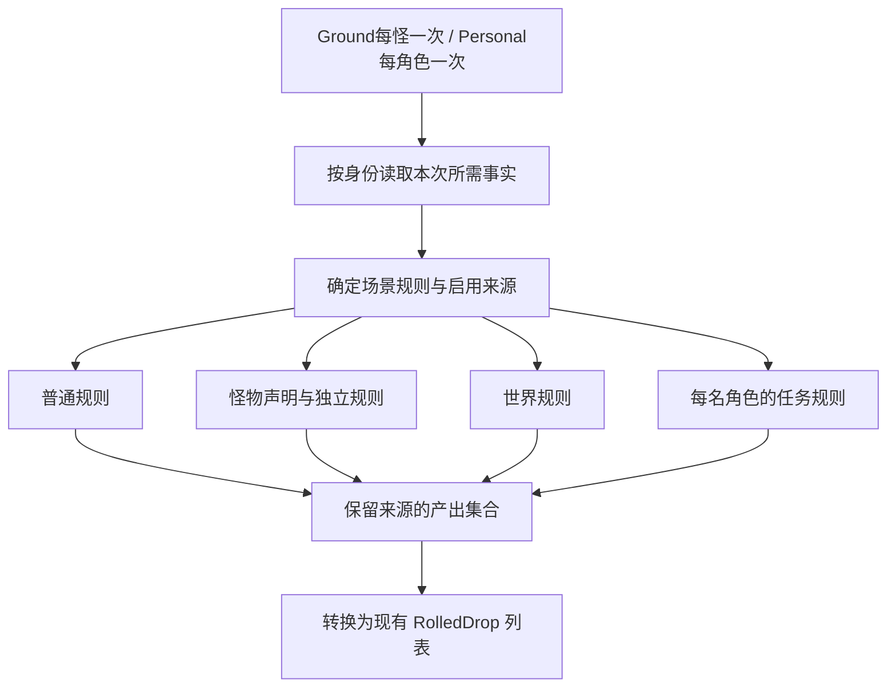

# 掉落来源实施方案

日期：2026-09-23。关联 #124；基线提交 `c658666f`。本轮交付分析与方案，本方案阶段没有修改生产代码或部署；后续已按用户确认拆分 Ground/Personal 接口，本文同步该边界。

落地状态（更新至 `171a3b54`）：Ground/Personal 已切分，普通与任务既有逻辑已迁移，世界、怪物声明及标签型 Extra 已接入；独立表、enemy reward 和特殊模式仍有空壳。当前状态及缺口见[内部切分与证据清单](掉落内部切分与证据清单.md)；下文完整来源算法、索引和模拟工具仍是方案。

补充取证：后续已取得 `1995chen/dnf` 分发仓库的 ELF，并静态追踪 Extra 编排与 RandomOption；样本来源和哈希见[Extra掉落机制](Extra掉落机制.md)。下文“尚未取得二进制”的描述是方案初稿时的历史状态，不能再作为当前结论；该分发样本也不等于已证明未经修改的官方 A21 服务端。

## 1. 结论与证据边界

使用 `IMonsterDropDomainService` 的 `GenerateGroundAsync(monsterId, context, ct)` 与 `GeneratePersonalAsync(monsterId, characterId, context, ct)`，各自组合地面与个人来源。先完成普通怪物场景中可核对的来源，再处理深渊、异界和其他特殊模式。调用方不读取任务、背包或权益快照。

70 台服的原始脚本、原版服务端调用链和可复现实验优先于现代仿真服代码。本轮检索到的是台服社区的历史笔记及后续转载，**尚未取得带版本/哈希的 70 台服原版二进制掉落调用链或原始实验记录**，不能将所有教程都标成权威定案。当前 A21 PVF 是本服数据结构的直接证据；它能证明有哪些值，不能独自证明服务端怎么使用这些值。

采用三个标记：

- **Confirmed（数据/代码）**：本轮直接读取本地档案或当前实现；不意味着原版算法已证实。
- **High（结构推断）**：形状与多个样例一致，尚缺消费链或受控实验。
- **Hypothesis（候选）**：只有上游实现、教程解释或缺少决定性证据；不据此自动启用生产规则。

### 历史资料的使用方式

| 资料 | 可用部分 | 限制 |
|---|---|---|
| [marstau 的台服部署/修改笔记](https://blog.marstau.com/2015/06/02/dnf%E5%9C%B0%E4%B8%8B%E5%9F%8E%E4%B8%8E%E5%8B%87%E5%A3%AB.html)，页面日期 2015-06-02 | 作者笔记列出普通、extra、深渊、世界、独立及异界表的分工，是查找原始数据的线索 | 页面持续增补，不能把所有段落锁定为 2015 年或某一原版 PVF；没有逆向调用链。它把稀有度分母写为末值 X，与当前实现 X−1 存在边界差异 |
| 老牛《DAF 爆率文件解析》[存档转载](https://vip.gmdnf.com/2024/dnf_jsfxjc/dnf_jxzy/daf爆率文件解析（完全版）/) | 可追溯的原作者线索为 bbs.ilaoniu.cn | 原站本轮不可访问，不能用转载独立证明算法；仅列为待回收原始实验资料 |
| 呆子一个的世界掉落原帖 [4079701531](https://tieba.baidu.com/p/4079701531) | 历史原帖线索 | 本轮无法获取正文，不用转载中的概率解释作定案依据 |

检索中还发现不同转载把独立掉落的内嵌列表说成“固定概率”或“相对权重”，数量列也有不同解释。这里只记录冲突，算法裁决依赖原始数据、原始消费链或受控实验。当前 `Docs/DropRates.md` 第七节对列表固定分母等写法也应按待复核历史结论使用。

## 2. A21 本轮直接盘点

档案：`E:/Project/DNF/DNFClient-A21-debug/Script.pvf`。

SHA-256：`19F5FA85FF73CCE94E299E0902269DE2F0164934128F15B8A7B99249C881BE1A`。

| 数据 | 本轮读取结果 | 对方案的影响 |
|---|---|---|
| `etc/independent_drop.etc` | 按 17 整数字段和可选 list 完整消费 3,046 条；末列模式 0 为 2,530 条，模式 1 为 516 条，没有模式 2 | 当前主表可先覆盖直出与内嵌池；不需要为了支持这份主表先实现异界外部池 |
| 独立掉落数量五列 | 1,330 条五列不全相同；存在 `1 2 3 4 4`、`1 3 5 8 4`、`1 2 3 5 2` | 不能用“五列都为 1”的简单样例证明数量轴含义 |
| `etc/independentdrop.lst` 和目录 | 索引 0 字节；目录中的 0_job_mapping_table 与 1..160 等表为空 | 暂时没有可用于异界外部池的有效本地数据；不得从文件名伪造奖励 |
| `etc/worlddrop.etc` | 200 个等级组；每组第二个整数字段均为 0；组末 -1；等级 1/20/70/85 的权重和分别为 310/8960/13434/8947 | 等级分组和配对结构可读；权重和并非固定 100%，需要单独裁决触发分母及空结果 |
| 深渊表 | 使用 `[dungeon difficulty drop prob]`，稀有度组里存在末基数与末门槛不满足普通表关系的值 | 必须用独立解析和算法，不能复用普通表读取器强行吞下 |
| `.qst` 全档案标签扫描 | 815 次 `[monster reward item]`、455 次 `[enemy reward item]` | 本服只读前者；后者需要补查。计数是全档案标签出现次数，不等于有效在用任务数 |

可复核工具为现有 `Tool/PvfProbe`：`dump`、`files independent`、`tags .qst`。统计脚本见 [drop-source-probe.py](outputs/drop-source-analysis-20260923/drop-source-probe.py)，输出见同目录 JSON。结构统计不作为未知字段语义的证明。

## 3. 按产出来源设计

| 来源 | 数据与当前基础 | 计划算法/职责 | 开工前要裁决的点 |
|---|---|---|---|
| 普通掉落 | `itemdropinfo_monseter.etc`；现有 DropRuleService/DropRules | 保留“类别是否命中→品质→品级范围内按 creation rate 选物品”；金币另算金额 | 五个类别槽的对应关系、四组品质阶梯的索引轴、基础率分母仍有推断；本阶段不能把现有实现自动升级为原版事实 |
| 普通 extra 表 | `itemdropinfo_monseter_extra.etc`；已能解析、当前怪物主入口没使用 | 作为同主题的另一个规则配置，先确定选择条件 | 是替换普通表、额外一轮还是特定场景配置；**禁止同时无条件跑两张表** |
| 金币金额与调整 | `itemdropinfo_common.etc`、来源表的 gold 段、`(r)itemdropinfo_control.etc` | 与金币触发率分开；基数、浮动、数量/金额倍率各自建规则，避免重复乘倍率 | control 的条件轴、单位与生效时机；不得把金币概率倍率当金额倍率 |
| 怪物自身声明 | `monster/monster.lst` 对应脚本 `[item]` | 建 monsterId→声明池索引；作为有来源标记的候选产出阶段 | `[item]` 是额外入口还是普通类别槽所选物品池；外层触发条件未知。上游硬编码 10% 不采用 |
| 指定怪物独立掉落 | `independent_drop.etc` | 按 monsterId 找所有规则→匹配条件→判定次数/概率→直出物品或从 list 抽取；多个规则可分别产出 | 数量轴、末尾筛选字段、list 权重/固定分母语义；不经过普通 creation rate 资格筛选 |
| 世界掉落 | `worlddrop.etc` | 按怪物等级取组，保留“本次无掉落”的概率；使用该来源自身规则 | 固定分母互斥区间、先过门再加权、各项独立掷这几种模型尚未裁决；不能把权重归一后每只怪必出一件 |
| 任务掉落 | `n_quest` 任务声明；当前 monster reward 已实现 | 每名参与者按 ID 查询进行中任务和持有量，匹配怪物/地下城/难度，按任务规则抽取并限制数量；返回归属角色与授予上限 | enemy reward 的触发对象和格式、同目标多任务的选择/合并规则；不能将它当 monster reward 的同义标签直接拼接 |
| 深渊 | `itemdropinfo_monster_hell.etc` 及深渊参与者/事件定义 | 独立规则配置；将怪物死一次与深渊事件结算一次区分，防止同场 APC 多次发完整奖励 | 难度轴、轮数、事件归属和替换/追加关系；不能一律硬编码“9件”或把每个怪都当结算点 |
| 异界外部池 | 独立表引用、`independentdrop.lst`、职业映射表 | 独立来源内部解析外部引用、职业池及难度池 | 当前数据缺失，暂列后置能力；拿到匹配版本数据后再实现 |
| 场景物件 | `.map`/`.dgn` 的特殊物件与奖励组、object 掉率表、被动物件脚本 | 共用抽样基础，但保持独立触发入口；保留组内权重和空结果 | 当前部分读取只取组内首项，需要改；物件声明与 object 表不能未经核对重复产出 |
| 通关翻牌 | `itemdropinfo_clearreward.etc`；已有独立闭环 | 保持结算服务，复用品质/加权抽取原语 | 不接到每个怪物的生成入口 中，不重复发放 |

区域材料、怪物卡片、领主专属装备应先查落在哪个现有来源，不按物品名称另建一套硬编码掉落。活动、任务助手等属于有适用范围的修正规则；不能将同一倍率无差别乘到普通、世界、任务和独立来源上。

## 4. 独立掉落的两个关键裁决

### 数量字段

候选 A：五列分别是五种难度的产出次数/数量。候选 B：前四列按队伍人数选尝试次数，第五列是最大产出数（本地旧上游使用这种解释）。两者不能混用。

最小差分：固定同一个含 `1 3 5 8 4` 的条目，将概率设为必定命中，在独立的 70 台服实验环境中固定难度切换 1/2/4 人，再固定人数切换难度。若原版二进制可用，直接追数量数组消费下标更快。**在本服实现一个候选再测本服，不能证明候选就是原版规则。**

这个裁决会影响 1,330 条记录，属于独立掉落正式接入前必须处理的算法问题。若暂时只做计数五列全为 1 的实验样例，应明确是受限验证，不作为全表完成。

### list 字段

当前 monster 20 的内嵌列表只有 `14400 1000`。候选设计是外层决定是否掉落，内层按相对权重选一件；它与“每个条目按 10000 分母独立命中”会产生不同空结果和多物品概率。

最小差分：固定外层必定成功，用一项权重 1000 与两项权重 1000/3000 对比是否出现空结果、单次最大件数和比例。取得原始消费链或原服样例后再定案。条目同物品不应按 itemId 去重，重复声明可能就是额外产出机会。

## 5. 服务内部结构

图中并列来源表示独立的编排边界，不宣称原版必然无条件同时运行。来源选择及替换关系由规则决定。

- 领域服务查询角色等级、职业、任务、背包及权益；只在一次调用内复用事实，避免同一来源多次读库。不把这些事实塞回对外 context，不要求角色在线。
- 规则服务读取静态内容和本次 facts，调用纯计算函数。采用明确的几个来源函数/服务即可，暂不搭通用插件框架。
- 来源内部保留 `SourceKind + RuleKey + 条目位置` 以追踪候选、未命中、空池与异常；投影成现有结果时保留物品、数量、归属和任务上限。外部业务不依赖每一种来源类型。
- 不按 itemId 合并装备实例或任务归属。多个来源给同一种物品可以是合法产出；同一规则是否只执行一次靠规则身份与生成生命周期保证。
- 随机源按怪物实例、来源和必要的角色身份分流。新来源不能多消耗几个随机数就改变普通来源结果；本阶段已验收的普通/任务种子序列应保留，改算法时单独说明。
- 查询生成不写背包、不扣权益额度、不分配地面编号。房间固定结果，死亡时实际发放仍做任务数量保护，避免预生成多个怪造成超发。

## 6. 缓存与模拟

建议和罐子一样：初始化阶段编译启用来源的不可变索引。不是每只怪读 PVF，也不先引入 LRU。

- 普通：按等级/品质/类别建立候选桶及累计权重。
- 指定掉落：monsterId→全部条目；list 提前计算累计权重与和。
- 世界：等级→原始条目及已确认的抽样结构。
- 任务：缓存任务静态声明；是否接取、库存数量和权益随调用按 ID 读取。
- 怪物声明：monsterId→原始奖励声明；先测启动解析耗时和驻留内存，再决定是否拆分初始化批次。

缺少怪物的额外掉落条目可以是合法空结果；**已引用的必需表/物品不存在、格式错误、启用来源遇到未支持模式**应报带路径与规则位置的明确错误。尚未启用的特殊来源输出能力清单，不伪装为已完整支持。

模拟工具调用同一规则，不建立第二套算法；用可替换的事实查询实现提供测试角色/任务状态，外部 API 仍传 ID。输出应包含各来源触发率、数量分布、品级/品质/物品频次、空结果原因及重放所需种子。性能数据须实测，不从条数估算成既成事实。

## 7. 实施顺序与每步验收

1. **整理数据与复核普通来源**：建立完整字段/证据表，标记未知列；补 trace 和小规模模拟入口。保留现有规则基线，对 extra 表、类别映射、稀有度边界、金币倍率逐项复核。验收：可定位每个产出来源，零/必定命中和品质边界不偏一，新增来源不扰动旧随机序列。
2. **指定怪物独立掉落**：先闭合数量轴和 list 语义，再接入直出与内嵌池。验收覆盖卡片、材料、领主装备、多个条目同时命中，以及不同难度/人数；全表解析与有效引用校验通过。
3. **世界与怪物自身声明**：先裁决触发条件和分母，再增加对应来源。验收必须包含“不掉任何世界物品”和重复命中分布，防止每怪必掉或重复叠加普通池。
4. **任务来源完整化**：保留当前 monster reward，调查并补 enemy reward 等在用格式，拆开事实查询和纯任务抽样。验收库存上限、多任务冲突、队员隔离、任务变更及多个预生成怪物的最终发放限额。完成后再接 #125 任务助手倍率。
5. **特殊来源**：深渊、异界、物件、活动按各自数据与触发生命周期分别完成。翻牌保持已验收入口，只抽取共享原语。缺失异界数据先补数据，不猜奖励。

每步可以独立交付；不因特殊来源未闭合而阻塞普通地图的已证部分，也不因一个简单样例成功就关闭整个 #124。

## 8. 推荐下一项

先做第 1 步的数据目录、普通来源复核和模拟支持，同时把第 2 步的两个未知量列成精确的台服取证任务。当前可以写解析器和验证器；独立掉落完整生成算法必须等数量轴/list 语义被证实，或由用户明确选择作为本服规则后再启用。

这份方案只确定内部改造次序和需要的证据。没有要求重新扩大 context、来源实现阶段不再改变这两个对外接口，也没有把上游硬编码常量当成 70 台服规则。
