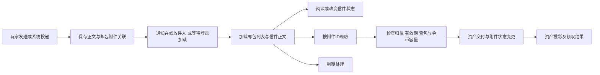

# 邮箱系统：70 流程与 A21 核对

## 范围与交付边界

2026-09-24，用户授权先还原70服务端的邮件业务与协议，再对照A21/86客户端静态消费链。领域模型与服务设计留待共同讨论；本轮不修改生产逻辑、数据库、客户端，也不部署。

所属：M08 / #44。任务助手每日人偶 #126 是邮箱的后续调用方；本轮不提前决定其每日发放规则。

阅读顺序：

1. [70服务端证据](outputs/mail-system-investigation/70-server.md)：状态变化、业务校验、持久化调用与报文顺序。
2. [86客户端证据](outputs/mail-system-investigation/86-client.md)：构包、解包、UI行为和静态边界。
3. [本服现状](outputs/mail-system-investigation/current-server.md)：已有登录投影与未完成业务，不能把已有表当成完整邮箱领域。

## 核对原则

- 70端是该版本行为证据，不能自动证明86 wire或当前业务政策。
- A21静态证明程序路径与读取方式，不等于实机已通过；不标为 ClientVerified。
- 旧文档的A12运行样本、参照服转录、A21静态结论分开对待。
- 相同 opcode 不保证布局相同；先比 selector/type，再比宽度、重复项、可选块、状态变更和UI结果。
- 未找到分支不等于功能不存在；到达保护区、间接调用或异步回调边界时明确记录缺口。

## 共同设计前需要回答的问题

以下是研究核对点，不是已确定的服务接口：

- 邮件正文与附件是否具有独立身份、状态和到期时间？一次领取的是整封信还是一个附件？
- 阅读、保存、删除、退回分别改变哪些状态？有附件时允许哪些操作？
- 金币与物品如何一起交付，背包不足/金币上限时是否整单拒绝？
- 发送扣除、收件人投递、领取入账如何保证原子性与重复请求不重复获利？
- 系统投递与玩家发送的共同点和差异是什么？离线投递何时提示？
- 过期清理与退回如何分开，重启后如何继续？
- 调度、任务助手资格与奖励内容由调用方决定；邮箱接受什么稳定凭证和投递数据，随后共同设计。

## 后续实机验收草案

研究完成、设计确认并实现后再执行，不要求用户现在操作：

| 场景 | 需要观察 |
|---|---|
| 系统给离线角色投递 | 重登提示、列表、正文与附件一致 |
| 在线投递 | 新邮件提示与列表更新，无需重登 |
| 正常领取 | 物品/金币到账，邮件状态同步，再领取不重复入账 |
| 背包满或金币上限 | 明确拒绝，附件与资产保持一致 |
| 领取后断线重登 | 无丢失、无重复，服务器权威状态一致 |
| 阅读/保存/删除/退回 | 仅执行客户端与设计允许的状态转换 |
| 邮件到期 | 显示、领取资格和持久化处理一致 |
| 玩家发送 | 收发双方资产、邮资、限制与失败恢复闭环 |

## 已交叉核实的核心边界

70邮件有两个相关但不同的对象：正文信件 `letter_id` 与附件邮包 `postal_id`。A21也保留了这一消费关系：领取请求005F取邮件对象中附件ID数组的一项；0086状态操作使用另一个邮件ID字段。具体地址与SQL见两份证据报告。

因此后续设计不能直接假定“领取整封邮件”和“删除/标记邮件”操作同一个ID。内部是否分聚合、如何命名和存储仍由我们共同确定；需要保持的协议事实是两个身份不可混淆。

本服现有0061编码给附件ID加0x40000000，与信件ID分开。这只是当前实现方案；该加法不是已证实的客户端规则，不应反推为领域ID设计要求。

另一个待设计边界是金币领取：当前角色AddGoldAsync可能只增加上限以内的部分。邮件不能直接把“调用成功”当作“附件金币全部到账”，必须在领取方案中明确检查实际入账或事先做全额可领取校验。这是本服接口约束，不是本轮已确定的70/86业务政策。

## 流程对照结果

这是70核心调用链与A21消费关系形成的业务骨架，不是本服已实现流程。图中H的原子保障由新设计解决：70所查路径采用内存结算加异步DB删除，不能将该实现顺序当作可靠事务方案直接照搬。

| 环节 | 70证据 | A21核对 | 当前结论 |
|---|---|---|---|
| 系统投递 | 系统单发/批量入口，正文与邮包持久化，异步通知 | 0061列表与0063提示消费链 | 可作为业务骨架；幂等与事务由本服设计 |
| 列表与正文 | postal与letter分别读取后组合 | 0061有两类变长记录 | 双身份关系一致，附件完整wire尚未闭合 |
| 打开 | CMD响应0x63 | CMD响应0x60 | 功能可对照，编号不同，A21请求体仍缺证据 |
| 附件领取 | CMD响应0x62，按postal键查找 | CMD0x5F，按附件ID数组一项请求 | 身份关系一致，不能用70 opcode |
| 正文状态 | CMD响应0x89，0/2/3分支 | CMD0x86，0/2/3分支 | 数值相容；中文按钮语义仍保留证据边界 |
| 玩家发送 | CMD错误响应0x61，扣除资产后异步建信 | CMD0x5E/0x13B共用响应处理 | 主流程存在；发送请求字段和失败补偿待补齐 |
| 移除通知 | 到期链发送NOTI0x62；ID与列表关系须逐项比较 | NOTI0x62按邮件ID移除本地邮件对象 | 不能与005F附件领取ID混用 |
| 在线新邮件 | NOTI0x63，未加载数 | NOTI0x63，u16正数进入提示 | 结构相近，不证明准确通知时机 |
| 到期 | 加载清理与在线计时；有限期与无限期 | 有期限显示和领取有效性判断 | 机制可借鉴，不能把70的15天直接定为本服规则 |
| 退回/COD | 本轮未闭合 | 本轮未闭合 | 不默认存在或默认删除需求；另行定向核对 |

**进度口径**：已完成第一轮70全流程骨架、A21核心静态对照及本服现状清点；不是全部邮件协议字段已经闭合。可以开始讨论领域边界，不能据此直接上线全部邮箱功能。

## 进入共同设计时的建议顺序

1. 先确定信件与附件邮包的身份和状态关系；UI协议编号不进入业务模型。
2. 确定投递、读取、领取、状态操作、到期分别由哪个服务/领域实例负责，以及一次用例的事务边界。
3. 优先形成系统投递→查看→领取→重登不重复的最小闭环；玩家发信、退回仍保留在#44总体范围。
4. 在实现具体协议前补齐该闭环所需A21字段。复杂装备/时装/宠物附件不能用普通材料通过代替验收。
5. 邮件能力验收后，再让#126调用它投递人偶；资格、每日调度和奖励生成不塞入邮箱服务。

以上为讨论顺序，不是未经用户确认的服务接口、类名或表结构决定。
